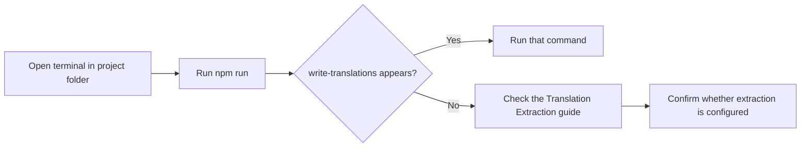

# How to generate translation files for localization

This guide explains how to generate translation files for localizing your site's interface. Before you can generate translations, you need to verify which localization commands are available in your project.

## Prerequisites

- Node.js and npm installed on your machine
- A local copy of your project that runs successfully

## Step 1: Open a terminal in your project folder

Navigate to the folder where your project lives and open a terminal there.

## Step 2: Review the commands your project provides

Run`npm run` without any extra arguments. This lists every command the project supports. Look for a command named`write-translations`, that is the standard name for generating translation files in this type of project.

Figure: How to check for translation extraction support

## Step 3: Check the result

In this project, the available commands are:

-`dev`
-`build`
-`build:dev`
-`preview`
-`lint`
-`format`
-`test`
-`test:watch`

None of these includes`write-translations`. This project does not currently ship a command for generating translation files, so translation file generation is not available out of the box.

## Expected result when translation extraction is available

When a project supports translation extraction, running`write-translations` produces one or more translation files, typically JSON or YAML files, that contain the user-facing text on your site. You can then translate those files and load them back into the project. If you do not see any such output, the command is not configured for this project.

## Next steps

- See what Translation Extraction involves: [Translation Extraction](doc:29cd6eff-ce01-4f01-a7ea-f21a8540b7bd)
- Follow the extraction procedure when available: [How to extract translation messages from source code](doc:df97b4a2-9b1d-48a6-b5bc-639363d70d35)
- Integrate extracted files with a translation management tool: [How to integrate extracted translations with translation management](doc:322bb9dc-cd16-43ee-8bf5-eda0be14aa8d)
