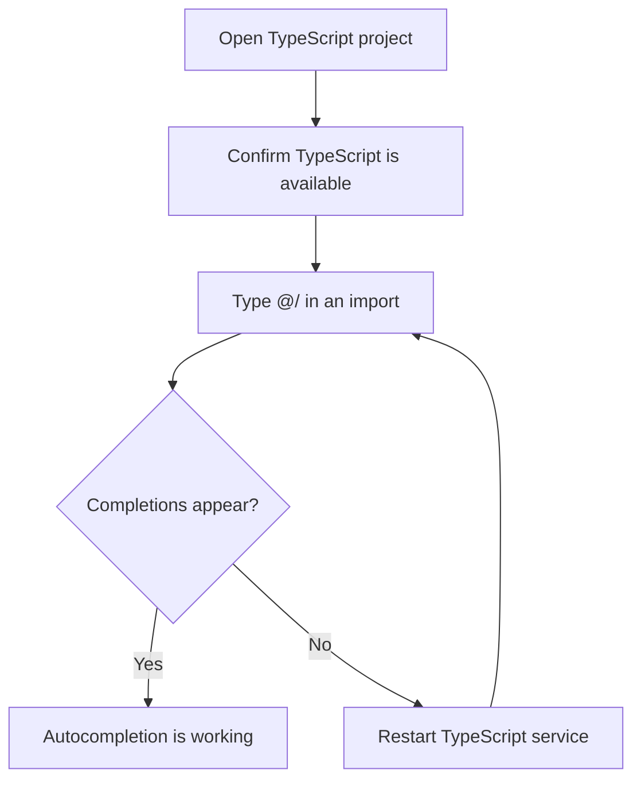

# How to get autocompletion for docusaurus modules in TypeScript

This guide helps you get editor autocompletion when you import modules in a TypeScript project. It walks through the prerequisites, the steps to verify autocompletion, and what to check when completions don't appear.

> [!NOTE]
> The source files provided for this project do not include Docusaurus packages or a Docusaurus configuration. Docusaurus-specific aliases cannot be verified from this source. The verified autocompletion ground truth in this repository is the local`@/` module alias, which is covered below and follows the same TypeScript resolution approach.

## Steps

1. Open your TypeScript project in the editor.
2. Confirm the project has TypeScript support. This repository declares TypeScript in its development dependencies.
3. In any module, start typing an import that uses the`@/` prefix. Project modules are imported this way throughout the source.
4. Watch for the completion list. It should offer matching modules as you type.
5. Select a completion to insert the import and check that type information becomes available.
6. If completions don't appear, restart the TypeScript language service from your editor's command palette, then try again.
7. For Docusaurus modules specifically, confirm that your project includes the relevant Docusaurus packages and alias configuration. The provided source does not include these, so Docusaurus module autocompletion cannot be confirmed in this repository.

The following diagram shows the verification flow you can follow.

Figure: TypeScript autocompletion check flow

## Expected result

When autocompletion is working, typing`@/` in an import statement shows a list of matching project modules. Selecting one inserts the resolved import, and your editor provides type information as you continue writing.

## Common issues

- **Stale completion list**: If suggestions are missing or out of date, restart the TypeScript language service in your editor.
- **Missing Docusaurus aliases**: The provided repository does not include Docusaurus, so Docusaurus module autocompletion is not available in this project. For Docusaurus autocompletion, you need a project that includes Docusaurus packages and the corresponding TypeScript alias configuration.
- **Editor and project TypeScript mismatch**: Make sure your editor uses the TypeScript version included with the project. This repository declares TypeScript 5.8.3.

## Related

- [TypeScript Module Aliases](doc:c7895a4c-96bd-4426-934c-73fc2ba9791e)
- [How to avoid TypeScript errors when importing generated modules](doc:c93d14b9-29d1-42fb-8055-0f99bc080ef7)
- [How to type custom theme components and plugins](doc:20b0c01d-fe91-40e8-a71c-c3b200c8c4c1)
