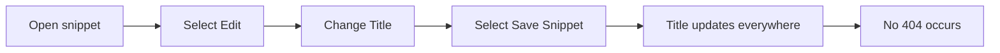

# How to handle page renames without 404s

When you rename a saved snippet, readers of your library never see a 404 page because CodeKnit does not use the snippet title as a web address. This guide shows how to rename a snippet safely and what to do if a renamed snippet seems to disappear.

## Prerequisites

- You have a CodeKnit workspace open with at least one saved snippet.
- You can see the snippet you want to rename in **All Snippets**, **Dashboard**, **Favorites**, or search results.

## Steps

1. Open the snippet you want to rename by selecting it from **All Snippets**, **Dashboard**, or the search results.
2. Open the snippet's **More actions** menu (the three dots), then choose **Edit**. You can also open the snippet detail view and select **Edit**.
3. In the **Title** field, replace the current name with the new name.
4. Select **Save Snippet**.

The flow looks like this:

Figure: Renaming a snippet from the library

## Expected result

The snippet keeps the same saved record, and only the title changes. The new title appears immediately in:

- The snippet card in **All Snippets**
- **Dashboard** counts and summary
- **Favorites**, if the snippet was starred
- **Recently Added**, if it is in that section
- Search results when you enter the new name

Because the title is not used as a web address, no 404 page appears for the old name.

> [!NOTE]
> CodeKnit stores your snippets on your device and does not assign a permanent web address to a snippet title, so renaming a snippet cannot produce a 404 page. For published pages on a documentation site, see [Client-Side Redirects](doc:900eb6c2-0c16-406d-a9d9-c4a4a600b85c).

## Common issues

- **The snippet seems to disappear after renaming.** Active filters can hide it. Enter the new name in the search box, or select **Clear Filters**.
- **The rename was not saved.** If you close the form without selecting **Save Snippet**, the old title remains. Open the snippet again and save the change.
- **Two snippets now have the same title.** Both snippets remain in the library and are distinguished by their description, category, tags, and code. No 404 occurs for the older item.

## Related

- [Client-Side Redirects](doc:900eb6c2-0c16-406d-a9d9-c4a4a600b85c)
- [How to redirect broken or legacy URLs](doc:f184b303-4e11-463c-a652-a1805c4e4d60)
- [How to configure redirect rules for localized paths](doc:83261685-f759-485c-ab93-e876b7a69a5f)
- [How to generate redirect pages at build time](doc:667e20e0-0f37-49dd-b9ea-c8cf180727d6)
- [Snippet Library](doc:9f431e10-b005-4cc0-80b1-0af4acdcb3d8)
- [Search and Filter](doc:3704cb56-cf68-421d-9db0-d3816a8af756)
