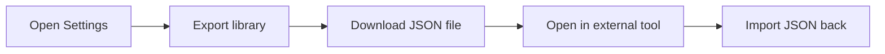

# How to integrate extracted translations with translation management

This guide covers connecting extracted translation content with an external translation management tool. In the current CodeKnit build, translation extraction itself is not implemented, so there is no direct integration with translation tools.

> [!NOTE]
> The available **Settings** import and export feature works only for your snippet library, not for translation content.

## What you can do instead

You can still move your saved data in and out of CodeKnit using the export and import options in **Settings**. This workflow downloads or uploads a single JSON file. Use it when you need a portable copy of your library, but don't expect it to contain translated text.

Figure: Available data exchange path

## Export your library data

1. Open the **Settings** dialog from the left sidebar.
2. Under **Export library**, select **Export**.
3. Choose a location for the downloaded file and save it.
4. When you're ready to bring the data back, open **Settings** again.
5. Under **Import library**, select **Import JSON**.
6. Select the saved file. CodeKnit keeps existing items and skips duplicates.

The downloaded file is named`codeknit-snippets.json`. It contains your saved snippets, not translation content.

## Expected result

A direct connection to a translation management tool is not available in this build. After exporting from **Settings**, you'll have a JSON file that can be opened in external tools, but it will contain snippet data rather than extracted translations.

## Common issues

- **I don't see any translation options**: Translation extraction is not part of this build. There is no translation file export or translation management connection.
- **My exported file has snippets but no translations**: The JSON export is designed for the snippet library only. Translation workflows are a separate capability that isn't present in this build.
- **Importing doesn't add translations**: Importing merges snippet data only; it will not create or update translation content.

For the translation capabilities this guide refers to, see:

- [Translation Extraction](doc:29cd6eff-ce01-4f01-a7ea-f21a8540b7bd)
- [How to extract translation messages from source code](doc:df97b4a2-9b1d-48a6-b5bc-639363d70d35)
- [How to generate translation files for localization](doc:bbfd60e0-925b-40b3-bf9d-cf9a1cf239fe)
