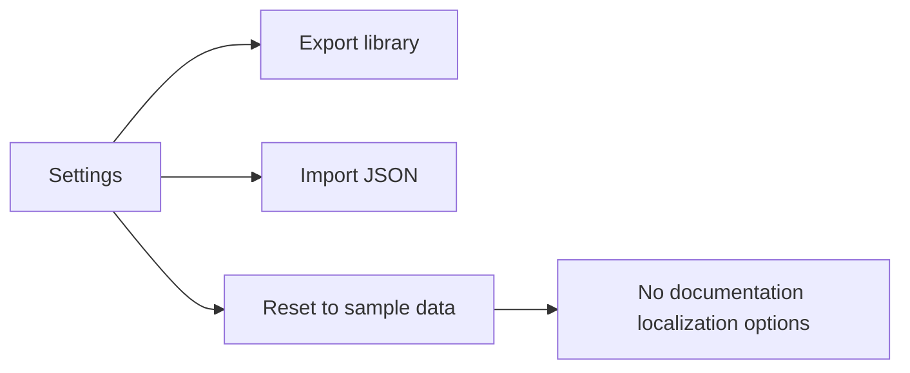

# How to localize documentation paths

> [!IMPORTANT]
> CodeKnit does not include a documentation localization feature in the provided build. You cannot change documentation paths from inside the app.

## Goal

You want site visitors to open documentation at language-specific paths, such as a French version under a dedicated locale area.

## Prerequisites

None. The settings that would contain documentation localization options are not present in CodeKnit.

## Current capability

The app's **Settings** panel covers snippet library data only. It offers three actions:

- **Export library**
- **Import JSON**
- **Reset to sample data**

There is no documentation section, no locale selector, and no path mapping controls.

Figure: Options available in CodeKnit Settings

## Steps to verify

1. Open the sidebar and select the **Settings** icon.
2. Review the dialog options.
3. Confirm that only snippet import, export, and reset actions are listed.

## Expected result

No documentation path localization is available. No changes are made to documentation paths.

## Common issue

You open **Settings** expecting a **Documentation** or **Localization** area, but only file import and export options appear. This is expected in this version.

If you publish documentation separately, configure localized routes in that platform. For related documentation features, see [Documentation](doc:7e97fe70-a638-4596-bb48-adfef8fb0b61), [How to configure documentation sidebar and paths](doc:85ed333a-1d37-4f3a-bf1e-57ed829c2fb1), and [How to navigate versioned documentation sets](doc:86645afe-97a4-4658-b7b5-fd86cd1aba8d).
