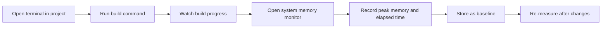

# How to measure build performance and memory usage

You can measure how long a production build takes and how much memory the build process uses. The build reports its elapsed time in the terminal, and you can watch memory with your operating system's monitor. Use these measurements to spot slow or resource-heavy changes early.

## Prerequisites

- The project is installed and its dependencies are in place
- You can open a terminal in the project folder
- You know how to open your computer's system memory monitor

## Measure a build

The project includes two ready-to-run build commands:

-`npm run build`, production-mode build
-`npm run build:dev`, development-mode build

Figure: Measuring build time and memory

1. Open a terminal in the project folder.
2. Run`npm run build` and keep the terminal open.
3. Watch the output as the build progresses. The command prints status messages as it works.
4. When the command finishes, note the total elapsed time shown in the terminal. This is your baseline build duration.
5. To compare development-mode timing, run`npm run build:dev`. Development mode skips some optimizations and may finish faster than a production build.

## Measure memory usage

The build command reports elapsed time but does not print a memory total. To capture memory:

1. Before starting a build, open your system memory monitor. Use **Activity Monitor** on macOS, **Task Manager** on Windows, or a terminal monitor such as`top` or`htop` on Linux.
2. Start the build again with`npm run build`.
3. Watch the memory reading for the build process during the entire run.
4. Record the highest memory value you see, together with the build duration.
5. Close unneeded applications before measuring if you want a repeatable number.
6. Re-run the build before and after making changes, then compare both memory and time against your baseline.

## Expected result

The terminal shows a successful completion message together with the elapsed time. You have two numbers you can track over time: the build duration and the peak memory used. If either number grows significantly after a change, that change is a candidate for optimization.

## Common issues

- **No completion message appears.** The build may have failed before finishing. Fix any reported errors, then run the command again.
- **Build time varies between runs.** Other running programs can compete for resources. Close unneeded apps and take more than one measurement.
- **Memory readings are inconsistent.** Record the highest value during the run at the same phase each time, rather than only reading the value after the command finishes.
- **The terminal closes before you can read the result.** Run the command in an already-open terminal so the output stays visible.

## Related

- [Logging & Diagnostics](doc:42850ad2-ae64-43c4-930f-731595c051ed)
- [How to view build progress and status messages](doc:1c979433-c5bf-4e10-8e5c-5a4822d74c52)
- [Performance Optimization](doc:df7d4ea6-c89c-4a8f-b056-db5fba77362b)
- [Site Building & Bundling](doc:0fcd8337-ee59-484f-bda3-4db080caa340)
