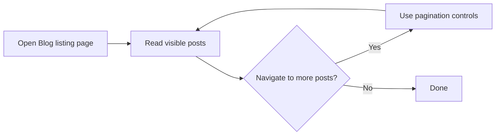

# How to paginate through blog listing

> [!IMPORTANT]
> The prefetched source files for this task cover CodeKnit's snippet library only. No blog listing or pagination code was provided, so the pagination controls for the Blog page could not be verified against actual code.

## Goal

Move between pages of blog posts on the Blog listing page when one page cannot show every published post.

## Prerequisites

- You are a Blog reader
- The blog contains more posts than a single listing page displays
- You have opened the Blog listing page

## What could not be verified

The provided source files do not include the Blog feature. Before this guide can be completed accurately, review the repository's Blog listing code to confirm:

- The visible labels on pagination controls (for example, previous/next links or numbered page buttons)
- How many posts appear per page
- Whether pagination changes when browsing by author or tag

## Understanding blog navigation

This flow reflects the general Blog reader journey. The pagination controls themselves must be confirmed from the Blog source code.

## Related guides

These Blog guides are documented and can help you navigate blog content:

- [Read blog posts](doc:8dec29d4-914f-42c1-ad4a-58b3923066cd)
- [Browse posts by author](doc:ca2bf8b1-3fe9-41c7-9f39-c0d952b34922)
- [Filter posts by tags](doc:da9e186e-2e74-4c49-9554-769d57a8aa79)
- [Blog feature overview](doc:9ee63f83-3e40-49be-87bd-7b6a57c9a4c9)
