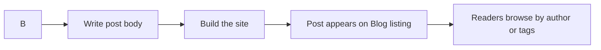

# How to publish a new blog post

Learn how to create and publish a blog post so readers can find it on the Blog listing, browse posts by author, and filter posts by tags.

## Prerequisites

- You have content author access to the site content files.
- You are familiar with basic Markdown formatting. For a refresher, see How to write Markdown content with front matter.

## How publishing works

When you publish a post, the site reads the metadata and body you provide, then displays the post on the Blog listing page. The metadata also makes the post available under author pages and tag pages.

Figure: Blog post publishing flow



## Steps to publish a new blog post

1. In the blog content area, create a new file named with the publication date followed by a short, descriptive slug. For example:`2025-05-12-welcome-to-codedocs.md`.

2. At the very top of the file, add metadata in **front matter** format. Include at least a **title**, **date**, **authors**, and **tags**:

```yaml
---
title: Welcome to CodeDocs
date: 2025-05-12
authors:
  - jane-doe
tags:
  - announcements
  - release
---
```

3. Below the metadata, write the body of your post using Markdown. You can include headings, lists, links, images, and code blocks:

```markdown
This is the first paragraph of the post.

## What's new

- Faster builds
- Improved search

Read the full release notes for more detail.
```

4. Save the file.

5. Build the site to verify your post is included. The exact build command depends on your site setup; if you are not sure, ask your site administrator. After the build, the post appears on the Blog listing page.

6. Open the Blog listing page and confirm your post is visible with its title, publish date, and tags.

7. Optional, open the post itself to verify the body renders correctly, then check the related author and tag pages to confirm the post appears there.

## Expected result

- Your post appears on the Blog listing page with the metadata you provided.
- Readers can select the post title to open and read the full content.
- The post is listed on the author page for each author you named.
- The post appears under each tag you added in **tags**.
- Readers can find the post through pagination if the listing has multiple pages.

## Common issues and fixes

**The post does not appear on the Blog listing page.** The most common cause is a missing or incorrectly formatted **date** value. Posts are ordered by date, so a malformed date can prevent the post from being listed. Check that the date follows the`YYYY-MM-DD` format.

**The post appears without author or tag links.** Confirm that the **authors** and **tags** metadata values match existing author and tag names exactly. Spelling differences create separate entries or omit the post from the expected pages.

**The post appears in the wrong position in the listing.** Posts are sorted by their **date** value, not by when the file was saved. Update the date metadata to place the post where you expect.

**The body renders incorrectly.** Verify your Markdown syntax, especially headings, lists, and code blocks. A broken code block can swallow the rest of the page content.

> [!NOTE]
> Site administrators can validate post metadata against a schema to catch errors at build time. If your site does this, read the build output for specific metadata errors rather than editing blindly.

## Related guides

- How to write Markdown content with front matter
- How to browse posts by author
- How to filter posts by tags
- How to read blog posts
- How to paginate through blog listing
