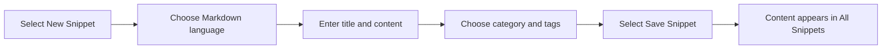

# How to publish a new blog post

> [!IMPORTANT]
> CodeKnit does not currently include a blog or post-publishing feature. There is no area for writing, managing, or publishing blog posts, so this goal isn't available in the product today.

## What you can do instead

CodeKnit is a library for saving and reusing written content and code. If you want to draft written material, you can save it as a Markdown snippet and keep it in your library.

### Save written content as a markdown snippet

Figure: Saving Markdown content as a snippet

1. Open CodeKnit.
2. Select **New Snippet** in the sidebar or the **New Snippet** button at the top.
3. In the **Language** list, choose **Markdown**.
4. Enter a **Title** for your content.
5. Add a **Description** if you want a short summary.
6. Choose a **Category**, or select **+ Custom category…** to create one.
7. Add **Tags** to group related content.
8. Write or paste your content in the **Code** area.
9. Optional: turn on **Mark as favorite**.
10. Select **Save Snippet**.

Expected result: your content is saved and appears in the **All Snippets** list.

Common issue: **Save Snippet** does nothing until you enter both a title and some content.

## Related

- [Your First Snippet – Quick Start](doc:72dab710-31b9-4980-becf-be9fbd6d4d94)
- [Product Overview](doc:ca8f433d-53d1-475b-a3a5-29b24f1ba173)
