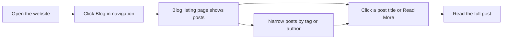

# How to read blog posts

This guide walks you through opening and reading a full blog post. If you're a site visitor, you can get to any published post from the **Blog** page in just a few clicks.

## Prerequisites

- You have a web browser and a working internet connection
- The site is live or running locally
- At least one blog post has been published

## Read a blog post

1. Open the website in your browser.
2. In the top navigation, click **Blog**.
3. On the **Blog** listing page, scan the posts. Posts are shown newest first, each with its title, date, author, and a short excerpt.
4. Click the post title or the **Read More** link for the post you want.
5. Read the full post on the post page.

Figure: Blog reading journey

When the post page opens, you can read the complete content, including text, images, and any embedded components. At the bottom of the page, you can usually move to the **Newer Post** or **Older Post** to continue reading more posts in order.

## Narrow down posts before you read

If you're looking for a specific topic, you can reduce the number of posts you need to scan:

- Click a tag on a post to see only posts with that tag. See [How to filter posts by tags](doc:da9e186e-2e74-4c49-9554-769d57a8aa79).
- Click an author's name to see only that author's posts. See [How to browse posts by author](doc:ca2bf8b1-3fe9-41c7-9f39-c0d952b34922).
- If the listing page has more entries than fit on one page, use the pagination controls at the bottom. See [How to paginate through blog listing](doc:cad40b05-f8e4-461f-8d6d-f8d68130ab6d).

## Expected result

After you click a post title, the full post page appears and shows the complete article with its title, author, date, tags, and body content. You can scroll through the entire post without leaving the page.

## Common issues

**The post I want doesn't appear on the first page.**
The **Blog** listing may be paginated. Use the pagination controls at the bottom of the listing page to see more posts.

**Clicking a post title shows a "Page not found" message.**
The post may have been unpublished, removed, or renamed. If you think the post should exist, contact the site administrator.

**The post appears, but images or styling look broken.**
The site may not have been built or published correctly. Try reloading the page, then contact the site administrator if the problem persists.

**I only want to read newly published posts.**
You can subscribe to the blog's RSS or Atom feed to stay updated without visiting the site. See [How to subscribe to RSS/Atom feed](doc:33a9a7d1-25c6-4d6c-a982-408eb7ab60c1).

## Related pages

- [Blog feature overview](doc:9ee63f83-3e40-49be-87bd-7b6a57c9a4c9)
- [How to filter posts by tags](doc:da9e186e-2e74-4c49-9554-769d57a8aa79)
- [How to browse posts by author](doc:ca2bf8b1-3fe9-41c7-9f39-c0d952b34922)
- [How to paginate through blog listing](doc:cad40b05-f8e4-461f-8d6d-f8d68130ab6d)
