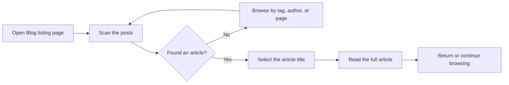

# How to read blog posts

This guide walks you through finding and reading a published article on the site's blog. As a reader, you start at the **blog listing page**, which shows published posts with the newest first.

Figure: Reading a blog post from listing to full article

## Prerequisites

- You know how to reach the **Blog** section of the site.
- At least one article has been published.

## Steps

1. Open the **Blog** section from the site's main navigation.
2. On the **blog listing page**, scan the list of articles. Each entry shows a title and a short preview.
3. Choose the article you want to read.
4. Select the article's **title** to open the full article.
5. Read the complete article on its own page, including the author, publication date, and tags.
6. When you're finished, do one of the following:
   - Select **Blog** in the navigation to go back to the listing.
   - Select a **tag** or the **author's name** to browse related writing.
   - Use your browser's **Back** button.

## Expected result

The full article opens on its own page. You can read the entire text and follow links within the page to related articles or back to the listing.

> [!NOTE]
> Exact button and link wording can vary with your site's theme. The article title is always the safest place to select when opening a post.

## Common issues

- **The article doesn't open when you select the card**, Some themes make the entire card clickable, while others require selecting the title itself. Try selecting the title text directly.
- **You can't find an article you saw earlier**, The article may have moved to an older listing page. Use pagination, or narrow the list by author or tag.
- **The article page appears empty**, Refresh the page. If the problem continues, the article may have been removed or unpublished.

## Related

- [Blog overview](doc:9ee63f83-3e40-49be-87bd-7b6a57c9a4c9)
- [How to paginate through blog listing](doc:cad40b05-f8e4-461f-8d6d-f8d68130ab6d)
- [How to browse posts by author](doc:ca2bf8b1-3fe9-41c7-9f39-c0d952b34922)
- [How to filter posts by tags](doc:da9e186e-2e74-4c49-9554-769d57a8aa79)
- [How to subscribe to RSS/Atom feed](doc:33a9a7d1-25c6-4d6c-a982-408eb7ab60c1)
