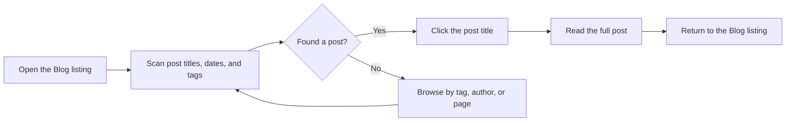

# How to read blog posts

This guide shows you how to open and read a blog post in the Blog area. You can browse the latest posts, open any article, and continue to related content through tags, author pages, or the RSS feed.

## Before you start

You need:

- A web browser that can reach the published site
- The web address of the site

You do not need to sign in or create an account to read posts.

## Read a blog post

1. Open the **Blog** listing page on the site.
2. Scan the listing to find a post that interests you. Each entry shows the post title along with the author, date, and tags.
3. Select a post by clicking its title.
4. Read the full post content that opens.
5. When you finish, return to the **Blog** listing or choose another post to continue reading.

Figure: Blog reading flow

## What you should see

After you select a post, the full article opens so you can read it from beginning to end. The Blog listing remains available whenever you want to return and pick another post.

## Common issues

- If selecting a post does not open it, make sure you are clicking the post title link rather than the surrounding summary area.
- If you do not see older posts in the listing, use the pagination controls to move through additional pages.
- If you cannot find a post by title alone, filter posts by tag or browse posts by author.
- If you want to be notified of new posts, subscribe to the RSS or Atom feed.

## Related

- [Blog](doc:9ee63f83-3e40-49be-87bd-7b6a57c9a4c9)
- [How to filter posts by tags](doc:da9e186e-2e74-4c49-9554-769d57a8aa79)
- [How to browse posts by author](doc:ca2bf8b1-3fe9-41c7-9f39-c0d952b34922)
- [How to paginate through blog listing](doc:cad40b05-f8e4-461f-8d6d-f8d68130ab6d)
- [How to subscribe to RSS/Atom feed](doc:33a9a7d1-25c6-4d6c-a982-408eb7ab60c1)
