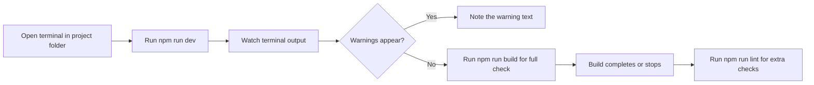

# How to receive warnings for configuration issues

This guide shows you how to see and respond to warnings about your project setup when you run the app locally. Warnings appear in the terminal and occasionally as a message on the Dashboard.

## How warnings appear

When you run the development server or a build, the command-line tools print status messages, warnings, and errors to the terminal. Warnings are the quiet signals that something in your setup needs attention, even if the app still starts.

Figure: Where to look for configuration warnings

## Steps

1. Open a terminal in the project folder.
2. Run`npm run dev` and keep the terminal window visible. This starts the local development server and prints status messages and warnings as the project loads.
3. Read each line of the terminal output. Warnings usually appear while the server starts or when a file changes during development. Treat any line labeled`warning` or highlighted in yellow as needing review.
4. For a full check, stop the development server and run`npm run build`. The production build prints all configuration warnings it encounters, then either completes or stops with an error.
5. To inspect a development-mode build, run`npm run build:dev`. To receive additional style and code-quality warnings from ESLint, run`npm run lint`.
6. If the build finishes without warning lines, your configuration is healthy. If warnings appear, read the message text to identify the setting, file, or dependency to fix.

## Related

- [View build progress and status messages](doc:1c979433-c5bf-4e10-8e5c-5a4822d74c52)
- [Debug errors with detailed context](doc:a9ead17d-7cce-4ed8-b0e6-f8578ab70072)
- [Logging & Diagnostics](doc:42850ad2-ae64-43c4-930f-731595c051ed)
