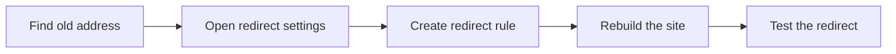

# How to redirect broken or legacy URLs

When visitors follow an old link, bookmark, or search result that points to a page that no longer exists, they see a "page not found" message. You can fix this experience by creating a redirect that automatically sends them to the current page.

## What you can achieve

This guide walks you through the overall workflow for redirecting broken or legacy addresses on your site. For scenario-specific step-by-step details, see the related guides at the end of this page.

> [!NOTE]
> Redirects are a site-level feature. You need administrator or maintainer access to create and change redirects.

## Prerequisites

Before you begin, make sure you have:

- Administrator or maintainer access to your site
- The old address you want to redirect visitors away from
- The new address you want visitors to land on
- The Client-Side Redirects feature available in your site settings

## Steps

### 1. Find the broken or legacy address

Identify the old page address that visitors are struggling to reach. Common sources include:

- Pages you renamed during a site update
- Links you removed
- Old search results that still point to the previous address
- External bookmarks that no longer resolve

### 2. Open the redirect settings

Go to the redirect settings for your site. This is where you manage the rules that tell your site how to forward old addresses.

### 3. Create a redirect rule

Add a new rule that maps the old address to the new address. The rule needs two pieces of information:

- **From**: the old or broken address
- **To**: the current address where visitors should land

### 4. Rebuild your site

Run the site build process. This generates the redirect pages that make your rule take effect for visitors.

### 5. Test the redirect

Open the old address in a browser and confirm that you land on the new page instead of an error page.

Figure: Redirect configuration flow

## Expected result

After you rebuild the site, anyone who visits the old address is automatically forwarded to the new address. They never see a "page not found" error.

## Common issues

- **Visitors still see a "page not found" page**, Confirm that the old address in your redirect rule exactly matches the address visitors are opening, including capitalization and any trailing slash.
- **The redirect works for one language but not others**, Localized versions of a page need their own redirect rules. See the localized redirect guide below.
- **You changed a redirect rule but nothing changed for visitors**, Rebuild the site so the updated redirect pages are generated and served.

## Related

- [Learn about Client-Side Redirects](doc:900eb6c2-0c16-406d-a9d9-c4a4a600b85c)
- [How to handle page renames without 404s](doc:3bba0cd8-b2ff-4a98-b4b7-c1569009a038)
- [How to configure redirect rules for localized paths](doc:83261685-f759-485c-ab93-e876b7a69a5f)
- [How to generate redirect pages at build time](doc:667e20e0-0f37-49dd-b9ea-c8cf180727d6)
