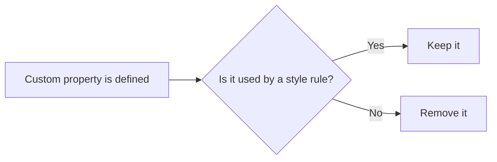

# How to remove unnecessary custom properties from CSS

Removing unused CSS custom properties keeps your stylesheet smaller and easier to maintain. This guide explains the goal and where it fits into CSS optimization.

## Prerequisites

- A project that uses CSS custom properties, which are variables written like`--brand-color`
- A CSS processing step in your build that can detect and remove unused variables

## Before you begin

A custom property is "unnecessary" when it is defined in one place but never referenced by a style rule. Clearing these out reduces the CSS bundle size and removes dead code that could confuse later edits.

Figure: Deciding which custom properties to remove

## Limitation in the current documentation set

The source files available for this guide do not include a CSSnano preset configuration or any custom property definitions from this project. Because the exact settings and commands must be verified against actual project code, the specific steps for this task cannot be documented accurately right now.

> [!NOTE]
> Without the CSSnano preset configuration, the settings that enable custom property removal cannot be verified from the current documentation set. See the related CSS Optimization pages for the options that are currently documented.

## Expected result

When this optimization is active, unused custom properties are removed during the production build. The result is a smaller CSS output and fewer unused variables to maintain.

## Common issues

The specific errors and fixes for this task are not available in the current source, so they cannot be listed here yet.

## Related

- [CSS Optimization](doc:9c358234-bd9b-41b5-8c0e-dc1b8be5ce61)
- [How to minify CSS assets for production](doc:ecfad4a4-133c-46ec-ac33-4d5b0d637ab3)
- [How to optimize CSS bundle size](doc:2d848518-523f-4344-b3fb-b15f92a93dff)
