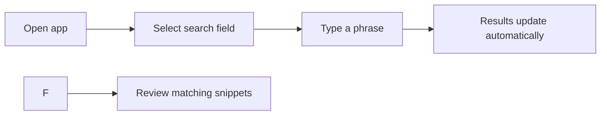

# How to search your snippets

This guide shows you how to find saved snippets quickly using the search bar and filters.

> [!NOTE]
> The search tools described here search your own snippet library, including snippet titles, tags, descriptions, and code. They are available on every page of the app.

## Prerequisites

- CodeKnit is open in your browser
- You have saved at least one snippet

## Steps

1. Open the app and look at the top header bar.
2. Select the search field that shows **Search snippets, tags, or code…**.
3. Type a word or phrase you remember from the snippet.
   - CodeKnit matches the text against snippet titles, tags, descriptions, and code content.
4. Review the results grid below, which updates as you type.
5. If you see too many results, narrow the list with the **Filter…** field or the language, category, and tag selectors below the heading.

Figure: Searching and narrowing snippet results

## Expected result

- The number shown next to the heading changes to reflect the matching snippets.
- Matching snippets stay visible in the grid or list.
- If no snippet matches, you see a **No snippets match** message with a **Clear filters** button.

## Common issues

- **No results appear**: try a shorter or more general term, or clear an active language or category filter.
- **Too many results**: use the **Filter…** field together with the language, category, and tag selectors to narrow the list more precisely.
- **Results seem out of order**: use the **Sort** selector to choose **Recently Added**, **Oldest First**, or **A–Z**.

## Related

- [Search and Filter](doc:3704cb56-cf68-421d-9db0-d3816a8af756)
- [Snippet Organization](doc:8367ddb8-1051-4848-a093-3b4352805aa4)
- [Snippet Library](doc:9f431e10-b005-4cc0-80b1-0af4acdcb3d8)
