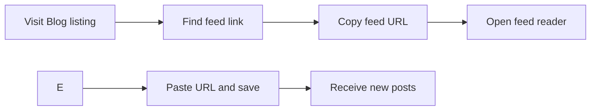

# How to subscribe to RSS/Atom feed

> [!NOTE]
> The source code supplied for this documentation set covers CodeKnit's snippet management. The Blog RSS/Atom feed implementation is not present in those files, so this guide reflects the Blog product map rather than verified implementation details.

## Goal

Subscribe to the Blog RSS or Atom feed so new posts appear automatically in your feed reader.

## Before you begin

- Install a feed reader app or browser extension, such as Feedly or Inoreader.
- Have access to the Blog listing page where the feed link appears.

Figure: Blog feed subscription flow

## Steps

1. Navigate to the Blog listing page.
2. Find the RSS or Atom link. Look for a **Subscribe** button, an RSS icon, or a link labeled **RSS** or **Atom**.
3. Copy the feed URL.
4. Open your feed reader.
5. Add a new subscription.
6. Paste the copied feed URL and save the subscription.

## Expected result

Your feed reader displays recent Blog posts and refreshes automatically when new posts are published.

## Common issues

| Issue | What to check |
|---|---|
| No feed link is visible | The Blog may not have the feed enabled. Contact the site administrator. |
| Feed reader shows nothing | The feed URL may be incorrect, or the Blog may have no published posts yet. |
| Updates are delayed | Feed readers check for new content on a schedule. Adjust the refresh interval in your feed reader's settings. |

## Related

- [What Blog is and who it is for](doc:9ee63f83-3e40-49be-87bd-7b6a57c9a4c9)
- [How to read blog posts](doc:8dec29d4-914f-42c1-ad4a-58b3923066cd)
- [How to browse posts by author](doc:ca2bf8b1-3fe9-41c7-9f39-c0d952b34922)
- [How to filter posts by tags](doc:da9e186e-2e74-4c49-9554-769d57a8aa79)
