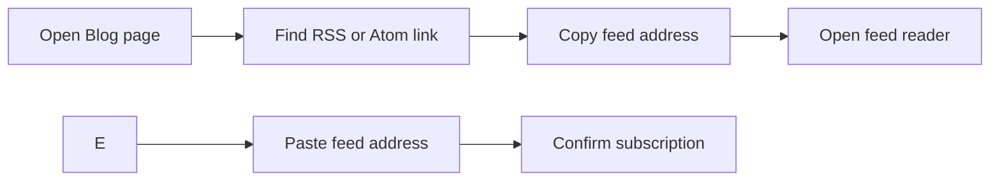

# How to subscribe to RSS/Atom feed

Keep up with new blog posts without revisiting the site. Subscribe to the blog's RSS or Atom feed, and your feed reader will collect new posts for you automatically.

## Prerequisites

- A feed reader or news aggregator on your device. Popular options include Feedly, NetNewsWire, NewsBlur, and Inoreader.
- Access to the **Blog** page in your browser.

## Steps

1. Open the **Blog** page from the site navigation.
2. Find the feed link on that page. Look for an **RSS** or **Atom** label, usually accompanied by a broadcast-style icon.
3. Right-click the feed link and choose **Copy link address** or **Copy shortcut**. If the link opens a new page, copy the feed address from that page's address bar instead.
4. Open your feed reader.
5. Create a new subscription. This is often labeled **Add feed**, **Subscribe**, or a **+** button.
6. Paste the copied feed address into the subscription field.
7. Confirm the subscription.

Figure: Blog feed subscription flow

## Expected result

Your feed reader adds the blog as a subscription and loads the most recent posts right away. From then on, new posts appear in your reader's update stream as soon as they are published.

## Common issues

- **The feed link opens code instead of a readable page.** Some browsers do not display feeds natively. Copy the address and add it to a dedicated feed reader instead.
- **Your feed reader says the address is invalid.** Re-copy the address and try again. Make sure the entire address was copied, with no extra spaces or missing characters.
- **No posts appear after you subscribe.** The blog may not have published any posts yet, or the subscription may need a moment to update. Refresh the feed in your reader after a few minutes.

## Related

- [What Blog is and who it is for](doc:9ee63f83-3e40-49be-87bd-7b6a57c9a4c9)
- [How to read blog posts](doc:8dec29d4-914f-42c1-ad4a-58b3923066cd)
- [How to browse posts by author](doc:ca2bf8b1-3fe9-41c7-9f39-c0d952b34922)
- [How to filter posts by tags](doc:da9e186e-2e74-4c49-9554-769d57a8aa79)
- [How to paginate through blog listing](doc:cad40b05-f8e4-461f-8d6d-f8d68130ab6d)
