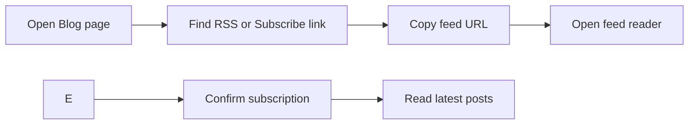

# How to subscribe to RSS/Atom feed

Follow this guide to subscribe to the blog's RSS or Atom feed so new posts appear automatically in your preferred feed reader.

## Prerequisites

- You can open the Blog page in your browser.
- You have a feed reader app or service, such as Feedly, Inoreader, or your browser's built-in feed feature.
- You know where to find the blog's feed URL, which is usually an **RSS**, **Atom**, or **Subscribe** link on the Blog page.

## Steps

1. Open the **Blog** page in your browser.
2. Locate the feed link. Look for an orange RSS icon, a feed icon, or a link labeled **RSS**, **Atom**, or **Subscribe**.
3. Copy the feed URL:
   - Right-click the link and choose **Copy link address**, or
   - Open the link and copy the URL from the browser's address bar.
4. Open your feed reader.
5. Add a new feed in the reader and paste the copied URL.
6. Confirm the subscription.

## Expected result

Your feed reader displays the blog's recent posts and updates automatically when new posts are published.

Figure: Feed subscription flow

> [!NOTE]
> The exact location of the feed link depends on how the Blog page is configured. If you don't see an **RSS** or **Subscribe** link, check the Blog page footer or sidebar, or contact the site administrator.

## Common issues

- **Feed URL not found**: Confirm you copied the complete URL, including`https://`.
- **No items in feed**: The feed may be empty if no posts have been published yet.
- **Feed not updating**: Feed readers refresh on their own schedule. Manually refresh the feed or check your reader's update interval.

## Related

- [Blog](doc:9ee63f83-3e40-49be-87bd-7b6a57c9a4c9)
- [How to read blog posts](doc:8dec29d4-914f-42c1-ad4a-58b3923066cd)
