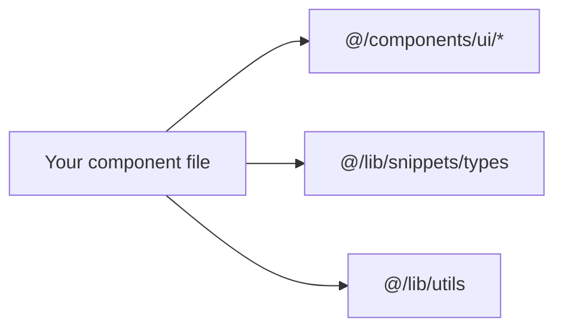
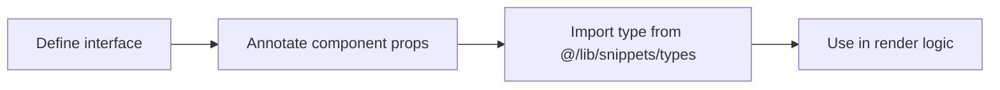

# How to type custom theme components and plugins

This guide helps theme and plugin developers add type-safe components to the CodeKnit codebase. CodeKnit uses TypeScript path aliases so you can import shared utilities and domain types without long relative import paths. The same patterns apply when you build new components, whether they plug into the existing snippet library UI or extend it.

> [!NOTE]
> This product does not ship a formal theme or plugin extension API. You can still create custom components in a TypeScript file and type them with the same aliases and interfaces used throughout the codebase.

## Prerequisites

- The project is installed and running locally
- You have a TypeScript file where you want to create a component
- You know the name of the shared type or utility you want to use

## Identify the import alias

In this project, imports that start with`@/` point to the project source folder. For example, a component can import a Button with:

```ts
import { Button } from "@/components/ui/button";
```

You use the same`@/` prefix to reach domain types and shared helpers. Common ones include:

| Import | What it provides |
| --- | --- |
|`@/lib/snippets/types` | Shared types such as`Snippet`,`SnippetFilters`, and`Language` |
|`@/lib/snippets/store` | Data operations for the snippet library |
|`@/lib/utils` | Shared utility helpers such as`cn` |
|`@/components/ui/*` | Existing UI building blocks such as Button, Input, and Dialog |

Figure: Importing shared types and UI components with the @ alias



## Create a typed component

Each custom component in the codebase declares a props type before the component function. This keeps props checked and prevents misspelled or wrongly typed values.

1. Create a new TypeScript file for your component.
2. Add imports for the types and shared UI pieces you need.
3. Declare an interface that describes the component's expected props.
4. Write your component so its parameter uses that interface.
5. For any domain type you expect, import it with the`type` keyword. For example:

```ts
import type { Snippet } from "@/lib/snippets/types";

interface Props {
  snippet: Snippet;
  onAction: () => void;
}
```

The existing components follow this same shape. A cards component expects a`Snippet` and several callback props; a filter component expects a`SnippetFilters` object and an update function.

## Reuse existing filter and language types

For components that deal with filters, the`SnippetFilters` type includes`language` and`sort` options. You can reference these directly without recreating them.

```ts
import type { SnippetFilters } from "@/lib/snippets/types";

type Language = SnippetFilters["language"];
type SortOrder = SnippetFilters["sort"];
```

The search and filter bar uses this approach when handling values from dropdowns, so a reader of your component gets the same type guarantees.

Figure: Typing a custom component with shared snippet types



## Expected result

You'll be able to create a new component, import shared types and UI blocks through the`@/` alias, and receive TypeScript feedback as you type. Existing pieces, including buttons, dialogs, and snippet types, appear with autocomplete where your editor supports it.

## Common issues and solutions

### A component prop type is missing or inferred as any

Ensure the component declares an interface and annotates its parameter. If a prop references a shared type, import it with`type`:

```ts
import type { Language } from "@/lib/snippets/types";
```

### A shared type is edited but component callers do not update

Type errors appear at usage sites when a required prop is removed or changed. Use`Partial<SnippetFilters>` when callers should be allowed to update only some filter fields.

### A type-only import triggers a lint or build error

Use the`type` keyword so the import remains erased at build time:

```ts
import type { Snippet } from "@/lib/snippets/types";
```

## Related

- [TypeScript Module Aliases](doc:c7895a4c-96bd-4426-934c-73fc2ba9791e)
- [How to get autocompletion for Docusaurus modules in TypeScript](doc:e1e6dfea-3f66-4c45-878a-8270f8c09dd2)
- [How to avoid TypeScript errors when importing generated modules](doc:c93d14b9-29d1-42fb-8055-0f99bc080ef7)
