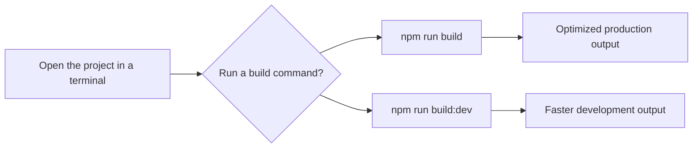

# How to use rspack bundler for faster builds

This guide explains how to speed up your site builds. It covers the faster build options that are currently available in this project, and it explains how to check whether Rspack is set up before you rely on it.

> [!NOTE]
> Rspack is not included in the current project configuration. The verified build tool for this project is Vite. The commands and behavior in this guide come from the project's build setup.

## What you can do

After reading this guide, you will be able to:

- Run the project's standard production build
- Run a lighter-weight development build
- Choose the faster build option for quick checks
- Confirm whether Rspack is present before making build changes

## Choose the right build command

When you open the project in a terminal, you choose between the standard build and the faster development build.

Figure: Choosing a build command

Use the development build when you need a quick check of the build output. Use the standard production build before you share or deploy the site.

## Expected result

When you run a verified build command, the terminal completes the build and produces a site bundle you can preview. The development build typically finishes faster because it applies fewer optimizations than the production build.

## Common issues

**I want to use Rspack, but I do not see it in the project.**
Rspack is not part of this project's current dependencies or scripts. You need to add and configure it before using it.

**The build fails because dependencies are missing.**
Run`npm install` before building.

**The development build is not as optimized as the production build.**
That is expected. Use the production build when you need a final, optimized bundle.

**I am not sure which build mode I need.**
Use the development build for a quick local check. Use the production build for deploying or sharing the site.

## Related guides

- [Build a production site](doc:23e09652-4772-4f32-a5b7-0121a8bc4853)
- [Enable faster build mode](doc:c4b28fd3-840d-4199-8d25-b0db7d1b0e49)
- [Site building and bundling overview](doc:0fcd8337-ee59-484f-bda3-4db080caa340)
