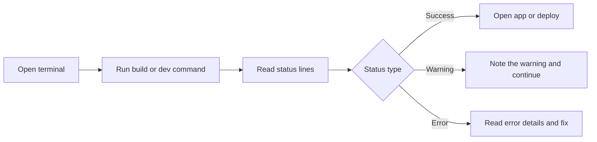

# How to view build progress and status messages

This guide shows how to watch CodeKnit's build and local server output from your terminal, so you can confirm a build succeeded, read warnings, and locate failures quickly.

The build, development, and preview commands in CodeKnit are provided as npm scripts. When you run these commands, the terminal prints progress and status messages that tell you what the tool is doing.

> [!NOTE]
> This guide covers terminal output from the build and server commands. In-app messages such as "Snippet saved" appear in the browser and are separate from build status.

## View a production build and status summary

The production build processes the app and prints progress lines as it works, ending with a success summary or an error.

1. Open a terminal in the project folder.
2. Run`npm run build`.
3. Watch the terminal as the build transforms files and bundles the app.
4. Confirm the output ends with a summary of the generated files and their sizes.
5. If the build stops early, read the last lines to see the file path and error message.

Figure: Viewing build progress flow

## Related

- [Logging & Diagnostics](doc:42850ad2-ae64-43c4-930f-731595c051ed)
- [How to measure build performance and memory usage](doc:2b46c98f-8208-4348-b81b-fbe839c07966)
- [How to receive warnings for configuration issues](doc:0343a837-0b25-4218-a962-ba9ae883f917)
- [How to debug errors with detailed context](doc:a9ead17d-7cce-4ed8-b0e6-f8578ab70072)
- [System Requirements and Installation](doc:1016cd5f-d53c-46d7-a74a-15b623ef5387)
