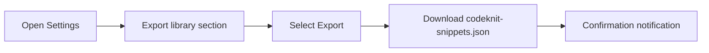
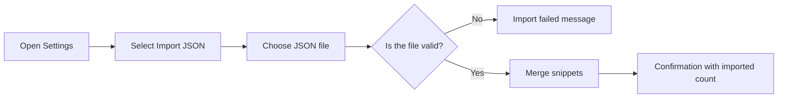
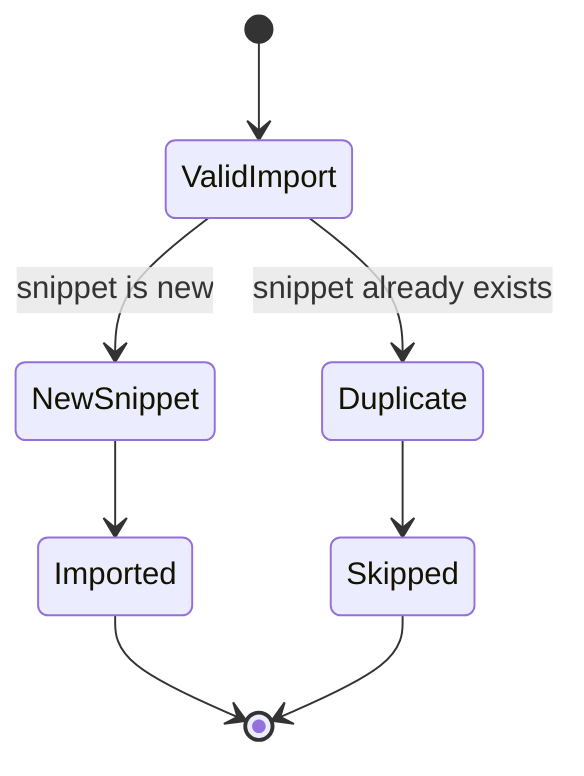

# Import and export

Import and Export lets you back up your entire CodeKnit snippet library, move it between devices, or share it with teammates. You can download all of your snippets as a single portable file, then restore or merge that file into another CodeKnit workspace.

This feature is useful when you want to:

- Keep a personal backup that is not tied to one browser or device.
- Share a set of snippets with a teammate.
- Track changes to your snippet collection over time in a version-control tool.
- Restore your library after clearing browser data or moving to a new computer.

You access Import and Export from the gear icon at the bottom of the sidebar. The **Settings** dialog includes both **Export** and **Import JSON** actions.

## Where to find import and export

Your snippets are stored locally in the browser you are using. The **Settings** dialog is the home for moving that data in and out.

1. Open the sidebar.
2. At the bottom, find your workspace area and select the **Settings** gear icon.
3. In the **Settings** dialog, you see **Export library** and **Import library** sections.

The dialog explains that your snippets are stored in this browser, and that you can export a backup or import a previously exported CodeKnit library.

## Back up your library

Exporting creates one downloadable file named`codeknit-snippets.json`. The file contains your complete snippet library in a readable format, so you can store it wherever you keep important files.

To export:

1. Open **Settings** from the sidebar gear icon.
2. Find **Export library**. The label shows how many snippets are currently in your library.
3. Select **Export**.

Your browser downloads the file automatically. A notification confirms the export and shows how many snippets were downloaded.

Figure: Export flow

The exported file includes every snippet with its title, description, language, code, category, tags, favorite status, and related dates. You can keep the file as a backup or commit it to a version-control system to track changes over time.

## Restore or merge snippets

Importing adds snippets from a previously exported CodeKnit file into your current library. You do not need to start from an empty library, importing is additive.

To import:

1. Open **Settings** from the sidebar gear icon.
2. Find **Import library**.
3. Select **Import JSON**.
4. Choose a valid CodeKnit JSON export file from your device.

The import validates the entire file before changing any saved snippets. Existing snippets are kept, and duplicates are skipped rather than overwritten.

After a successful import, a notification tells you how many snippets were imported and how many duplicates were skipped. If the file contains no new snippets, you receive a message that no new snippets were imported.

Figure: Import and validation flow

## Duplicate handling

When you import a file that contains snippets already in your library, CodeKnit keeps your existing snippets and skips the incoming duplicates. This behavior preserves the version already saved on the current device.

Figure: How duplicates are handled

Because duplicates are skipped, importing cannot be used as a way to overwrite changes already saved in the current library. There is no prompt to choose between an existing snippet and an imported one.

## What import and export support

- Export the entire library in one action.
- Import a full library export from another device or teammate.
- Merge on import by keeping current snippets and adding only new ones.
- Skip duplicate snippets automatically.
- See a confirmation after import that reports the number of imported and skipped snippets.
- See an error message if the selected file cannot be read or does not have the expected structure.

## What import and export do not do

- Importing does not partially update existing snippets. Duplicates are skipped, not merged field by field.
- Importing does not offer conflict resolution when the same snippet exists in both places.
- Exporting does not create a file that users typically edit by hand; the file is designed as a portable backup.

## Related pages

- [Snippet Library](doc:9f431e10-b005-4cc0-80b1-0af4acdcb3d8)
- [Snippet Organization](doc:8367ddb8-1051-4848-a093-3b4352805aa4)
- [Favorites](doc:b66c5560-9b68-42eb-922d-a8aecab0dfcb)
- [Search and Filter](doc:3704cb56-cf68-421d-9db0-d3816a8af756)
- [Product Overview](doc:ca8f433d-53d1-475b-a3a5-29b24f1ba173)
