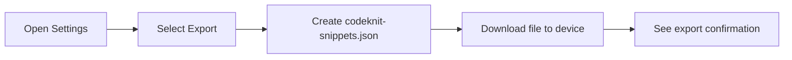
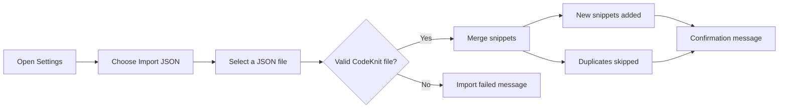

# Import and export

CodeKnit stores your snippets locally in the browser. Import and Export give you a portable path for backing up your library, moving it to another device, or sharing it with teammates, all through a single JSON file.

## Who it's for

Import and Export are for anyone who wants to keep their snippets safe or share them. Because there's no cloud sync built in, exporting is the main way to create a backup or take your library with you.

## What you can do

- **Export your library** as one download named`codeknit-snippets.json`.
- **Import a previously exported library** into your current browser.
- **Merge libraries** without losing what you already have.
- **Confirm results** with clear messages after every export and import.

## Export your library

Exporting downloads your entire library, every title, description, language, category, tag, code block, favorite status, and timestamp, into a single, human-readable JSON file.

To export:

1. Select the **Settings** gear icon in the sidebar.
2. In the **Export library** row, select **Export**.
3. CodeKnit downloads`codeknit-snippets.json` to your device.
4. A confirmation message shows how many snippets were downloaded.

> [!TIP]
> Keep a copy of`codeknit-snippets.json` in a shared drive or file storage tool. Because it's plain JSON, teammates can open it or import it into their own CodeKnit library.

Figure: Exporting your library

## Import a library

Importing adds snippets from a CodeKnit export file into your current library. It's a merge, not a replacement: the snippets already saved stay in place, new snippets come in, and duplicates are skipped.

To import:

1. Select the **Settings** gear icon in the sidebar.
2. In the **Import library** row, select **Import JSON**.
3. Choose a CodeKnit export file, such as`codeknit-snippets.json`.
4. CodeKnit checks the entire file before changing anything.
5. A confirmation message tells you how many snippets were imported and how many duplicates were skipped.

If the file is not a valid CodeKnit export, nothing is imported. You'll see an **Import failed** message with the reason, and you can choose the file again after fixing it.

Figure: Importing and validating a library

## Understanding merge behavior

Import is additive:

- **New snippets** from the file are added to your library.
- **Existing snippets** in your browser are left untouched.
- **Duplicates** between the file and your library are skipped, not overwritten.

You can't import only part of a file. If you want to bring in a few snippets, create a file that contains only those snippets first.

## Limits and boundaries

- **No partial import**: the import includes every snippet in the selected file.
- **No conflict resolution**: if a snippet in the file matches one already in your library, the imported copy is skipped rather than merged or updated.
- **No overwrite protection choice**: duplicates are always skipped; there is no option to replace an existing snippet with the imported version.
- **Valid CodeKnit files only**: the import accepts JSON, but the structure must match a CodeKnit export. Random JSON files will fail validation before anything is added.

## Related

- [Snippet Library](doc:9f431e10-b005-4cc0-80b1-0af4acdcb3d8) for how snippets are stored and viewed
- [Snippet Organization](doc:8367ddb8-1051-4848-a093-3b4352805aa4) for categories and tags included in an export
- [Product Overview](doc:ca8f433d-53d1-475b-a3a5-29b24f1ba173) for a general introduction to CodeKnit
- [Your First Snippet – Quick Start](doc:72dab710-31b9-4980-becf-be9fbd6d4d94) for creating snippets before you back them up
