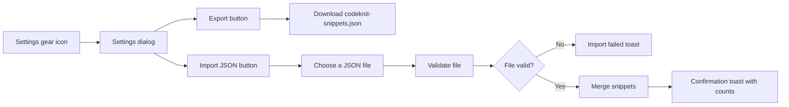

# Import and export

CodeKnit lets you back up, share, and restore your entire snippet library through the **Settings** dialog. You can download all your snippets as a single portable file, then import that same file on any device to recreate or merge your library.

## Who this is for

Import and Export is for anyone who wants to:

- Keep a safe backup of their snippets
- Move a snippet library between devices or browsers
- Share snippets with teammates
- Keep a version history of their library

## Why you would use it

Your snippets are stored locally in your browser. Exporting gives you a portable copy you control. The export file is a single, human-readable JSON file named`codeknit-snippets.json`. Because it is a plain text file, you can store it in a backup folder, attach it to a chat, or track changes to it in a version control system such as Git.

Importing reads that same file and merges its contents into the current library. This makes it easy to pick up your work on a new computer or bring in a teammate's exported collection.

## Accessing import and export

Open **Settings** by selecting the gear icon in the left sidebar. The **Settings** dialog contains three areas:

- **Export library**
- **Import library**
- **Reset to sample data**

Every action in this dialog works with the snippets saved in the current browser. The dialog itself shows a reminder that CodeKnit keeps your snippets in this browser.

Figure: Export and import flow


## Export your library

Exporting is a one-click download of your complete library.

1. Open **Settings** with the gear icon in the sidebar.
2. Find the **Export library** section. It shows the number of snippets that will be included.
3. Select **Export**.
4. Your browser downloads a file named`codeknit-snippets.json`.
5. A toast message confirms the export and states how many snippets were downloaded.

The resulting file includes every snippet in your current library in a readable format. You can open it with any text editor if you want to inspect its contents.

## Import a library

Importing brings a previously exported CodeKnit file into your current library.

1. Open **Settings** with the gear icon in the sidebar.
2. Find the **Import library** section.
3. Select **Import JSON**.
4. Choose a`codeknit-snippets.json` file from your device. The file picker accepts JSON files.
5. CodeKnit reads the file and validates it before changing anything in your library.
6. After a successful validation, CodeKnit merges the file's snippets into your library.
7. A toast message reports how many snippets were imported and how many duplicates were skipped.

While an import is in progress, the button changes to **Importing…** and is unavailable. You can select the same file again after correcting it if an import fails.

### Duplicate handling

If the file contains a snippet CodeKnit recognizes as a duplicate of one you already have, the existing snippet is kept and the duplicate is skipped. CodeKnit does not ask which version to keep and does not merge parts of both versions. Your existing library is never removed by an import.

Figure: Text here to make the caption feel natural. Wait, that is not correct. Let me fix: the diagram below shows import validation and duplicate outcomes.

Figure: Import validation and outcomes
```mermaid
stateDiagram-v2
    [*] --> Reading file
    Reading file --> "Validation failed: Invalid file" : Invalid format
    Reading file --> Merging : Valid file
    Merging --> "All duplicates" : 0 snippets imported
    Merging --> "Some imported" : 1 or more imported
    "All duplicates" --> [*]
    "Some imported" --> [*]
    "Validation failed: Invalid file" --> [*]
```

### Import notifications

After every complete import, a toast message summarizes what happened:

- **No new snippets imported**, the file only contained snippets CodeKnit already had, with the duplicate count shown.
- **Import complete**, one or more snippets were added, with the imported count and any duplicate count shown.
- **Import failed**, the file could not be read or did not contain a valid CodeKnit export.

## Boundaries and important notes

- Import is a one-way merge into the current library. It never removes existing snippets.
- Duplicate snippets are skipped. There is no conflict resolution and no choice to overwrite an existing snippet with an imported version.
- Export always creates the same filename,`codeknit-snippets.json`.
- The import file must match the structure of a CodeKnit export. A file with valid JSON but an unexpected format will fail validation.
- Export includes all snippets at the moment you click **Export**. New or changed snippets after that moment are not included in the earlier file.

> [!NOTE]
> Importing the same file more than once will skip the snippets you already imported, because they now count as duplicates.

## Related

- [Snippet Library](doc:9f431e10-b005-4cc0-80b1-0af4acdcb3d8), the collection you back up and restore
- [Snippet Organization](doc:8367ddb8-1051-4848-a093-3b4352805aa4), how categories and tags help organize what you export
- [Favorites](doc:b66c5560-9b68-42eb-922d-a8aecab0dfcb), favorite status is included when you move your library
- [Product Overview](doc:ca8f433d-53d1-475b-a3a5-29b24f1ba173), a broader look at what CodeKnit does
