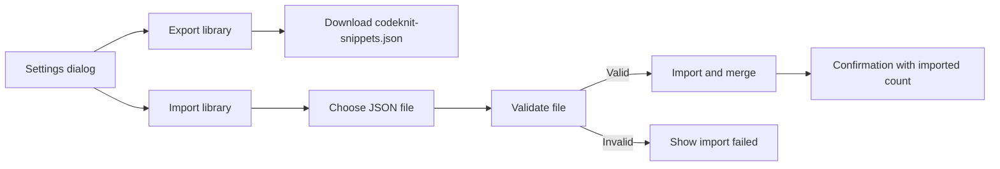
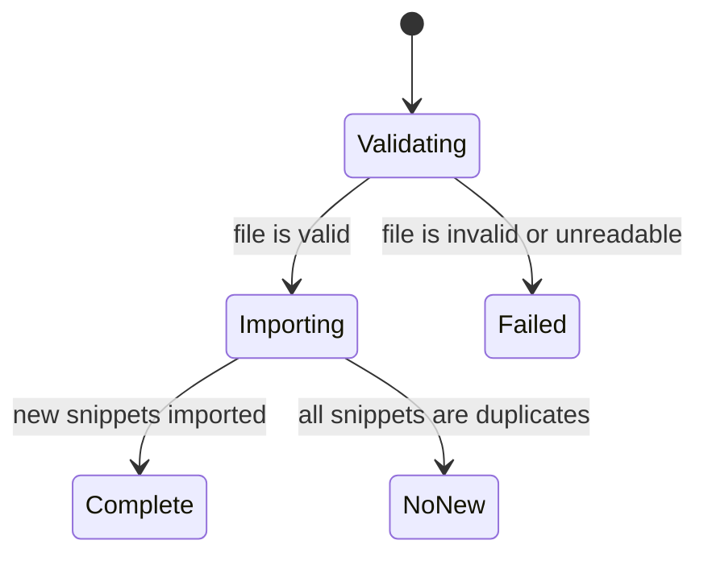

# Import and export

Import and Export lets you back up, share, and restore your entire snippet library through a single portable JSON file. You can export every snippet in one click, keep that file as a backup, share it with teammates, or move your library to another device. When you later import that file, CodeKnit validates it and merges its contents into your current library.

The feature lives in the **Settings** dialog. To reach it, select the gear icon in the lower-left area of the sidebar.

Figure: Export and import flow

## Why back up or share your library

Export creates a complete snapshot of your snippets in a format that is both portable and human-readable. You can use that snapshot to:

- Keep a personal backup in case you clear or replace your browser data.
- Move all snippets to another device.
- Share a set of snippets with teammates.
- Store the exported file in a version control or file-history system for an extra layer of protection.

## Export your library

Export downloads all of your snippets as a single JSON file.

1. Open **Settings** from the gear icon in the sidebar.
2. Under **Export library**, select **Export**.
3. Your browser downloads a file named`codeknit-snippets.json`.

The file is formatted for easy reading and contains the complete contents of your library. A confirmation appears with the number of snippets downloaded.

## Import a previously exported library

Import allows you to restore a backup or merge snippets from another CodeKnit export.

1. Open **Settings** from the gear icon in the sidebar.
2. Under **Import library**, select **Import JSON**.
3. Choose a previously exported`.json` file.
4. Wait while CodeKnit validates the file and merges its snippets. The button shows **Importing…** during this time.
5. Review the confirmation that appears when the import finishes.

The file must be a valid CodeKnit JSON export. Before anything is added to your library, CodeKnit validates the entire file structure. If the file is invalid or unreadable, nothing is imported and an **Import failed** message appears.

Figure: Import outcome states

## How duplicate handling works

Import merges rather than replaces. Snippets already in your library are kept, and incoming snippets that are recognized as duplicates are skipped. The confirmation tells you exactly what happened:

- **Import complete** shows the number of snippets imported and, when relevant, the number of duplicates skipped.
- **No new snippets imported** appears when every incoming snippet was a duplicate.

There is no conflict resolution during a merge. If a duplicate is detected, CodeKnit skips it rather than asking you to choose between your version and the incoming version.

## Move snippets between devices

1. On the first device, open **Settings** and select **Export** to download`codeknit-snippets.json`.
2. Move that file to the second device using your preferred method, such as a shared drive, email, or USB transfer.
3. On the second device, open **Settings**, select **Import JSON**, and choose the exported file.
4. Review the confirmation to see how many snippets were added.

## What import and export do not do

- Import works only with files exported by CodeKnit. Other JSON files are rejected.
- Import does not support partial updates or selective merging. The whole file is validated and then merged.
- Duplicate snippets are skipped, not overwritten, and there is no conflict-resolution step.
- Export downloads a snapshot at the moment you select **Export**. Changes made afterward are not included until you export again.

## Related

- [Snippet Library](doc:9f431e10-b005-4cc0-80b1-0af4acdcb3d8)
- [Snippet Organization](doc:8367ddb8-1051-4848-a093-3b4352805aa4)
- [Dashboard](doc:0cccb845-62f3-4e2b-b0ca-c7d768eaf700)
- [Product Overview](doc:ca8f433d-53d1-475b-a3a5-29b24f1ba173)
