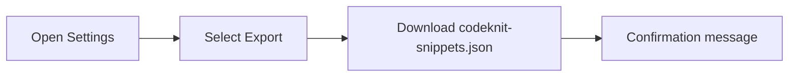
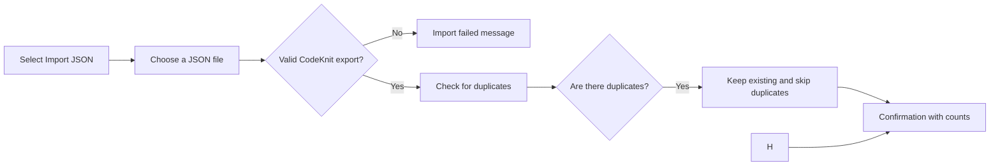

# Import and export

You can move your entire snippet library in and out of CodeKnit as a single file. Import and Export gives you a portable way to back up your work, move snippets between devices, and share a library with teammates.

The file you export is named`codeknit-snippets.json`. It contains all of your snippets in a human-readable format that you can store, share, or track over time.

## Why use import and export

You can use this feature to:

- Back up your library before clearing your browser or resetting data
- Move snippets from one device to another
- Share a full set of snippets with a teammate
- Keep a snapshot of your library that you can restore later

Because your snippets are stored only in the browser, exporting a file is the main way to keep a copy outside of CodeKnit itself.

## Where to find it

Open **Settings** by selecting the gear icon in the sidebar. The Settings dialog shows two actions under your library:

- **Export library**, downloads all your snippets as a JSON file
- **Import library**, merges snippets from a previously exported CodeKnit file

## Export your library

Exporting creates a snapshot of your current snippets and saves it to your device as a downloadable file.

Figure: Export flow

1. Open **Settings** from the gear icon in the sidebar.
2. Next to **Export library**, select **Export**.
3. Your browser downloads`codeknit-snippets.json`, which contains your complete library.
4. CodeKnit confirms the download with the number of snippets exported.

## Import a library

Importing reads a previously exported CodeKnit file and adds the snippets it contains to your library. CodeKnit validates the file first, so it only imports files in the expected format.

Figure: Import flow

1. Open **Settings** from the gear icon in the sidebar.
2. Next to **Import library**, select **Import JSON**.
3. Choose a`codeknit-snippets.json` file from your device.
4. CodeKnit validates the file before changing anything in your library.
5. If the file is valid, CodeKnit merges the snippets into your library.
6. A confirmation tells you how many snippets were imported and how many duplicates were skipped.

If the file is not a valid CodeKnit export, import fails and your existing library stays exactly as it was.

## How duplicates are handled

Import is a merge, not a replacement. Existing snippets are always kept. If the imported file contains a snippet that already exists in your library, CodeKnit skips that duplicate and continues with the rest.

Import does not overwrite or update an existing snippet with the imported version. It also does not offer a choice to resolve conflicts between duplicates, the saved copy simply wins and the duplicate is skipped.

If the file contains only duplicates, you see a message that no new snippets were imported.

> [!TIP]
> Export a backup before you reset your library or move to another device. The exported file is your safety net if you need to restore your snippets later.

## Limitations

- Import only merges snippets; it does not overwrite or update existing entries.
- There is no conflict resolution when duplicates are found.
- Import accepts only CodeKnit JSON export files in the expected structure.
- Export downloads all snippets at once; there is no option to export a single snippet or a filtered subset.

## Related

- [Product Overview](doc:ca8f433d-53d1-475b-a3a5-29b24f1ba173)
- [Snippet Library](doc:9f431e10-b005-4cc0-80b1-0af4acdcb3d8)
- [Snippet Organization](doc:8367ddb8-1051-4848-a093-3b4352805aa4)
- [Dashboard](doc:0cccb845-62f3-4e2b-b0ca-c7d768eaf700)
- [Favorites](doc:b66c5560-9b68-42eb-922d-a8aecab0dfcb)
