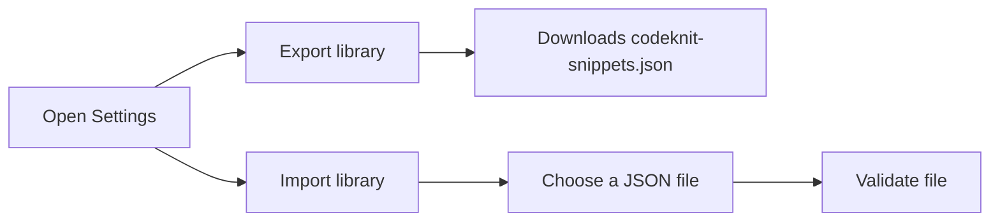
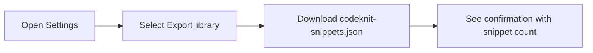
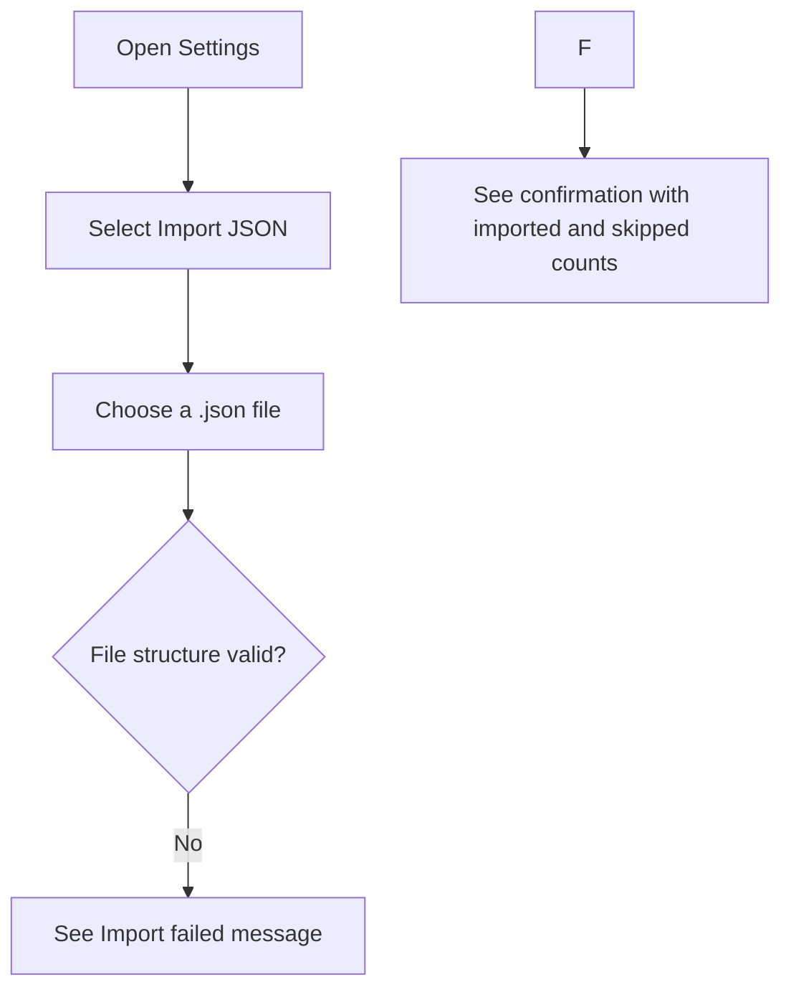

# Import and export

Import and Export lets you back up, share, and restore your entire snippet library through a single JSON file. When you export, CodeKnit downloads all of your snippets into a portable file named`codeknit-snippets.json`. When you import, CodeKnit reads that same kind of file and adds any new snippets to your current library.

This feature is for anyone who wants to protect their saved snippets, move them between devices or browsers, share a collection with teammates, or track their library in a version control system such as Git.

## Accessing export and import

Open Settings by selecting the gear icon at the bottom of the sidebar. The Settings dialog shows **Export library** and **Import library**, along with a separate **Reset to sample data** action.

Figure: Import and export overview

## Export your library

Export creates an immediate download named`codeknit-snippets.json`. The file contains every snippet currently in your library, formatted in readable, indented JSON. You can open it in any text editor to view titles, code, languages, categories, tags, favorite status, and dates.

Export is useful when you want to:

- Keep a backup copy of your snippets outside the browser
- Share a full snippet collection with a teammate
- Save a snapshot of your library to Git or another version control system
- Move your snippets to a new device or browser

To export, open Settings and select **Export library**. CodeKnit downloads the file and shows a confirmation message with the number of snippets downloaded.

Figure: Export flow

## Import a library

Import merges snippets from a previously exported CodeKnit JSON file into your current library. When you choose a file, CodeKnit validates the entire file before making any changes. If the file is valid, CodeKnit adds new snippets and skips duplicates. Your existing snippets are kept exactly as they are.

To import, open Settings and select **Import JSON**, then choose a`.json` file from your device. After the import, a confirmation message shows how many snippets were imported and how many duplicates were skipped.

Figure: Import flow

If the imported file contains no new snippets because every entry is already in your library, CodeKnit shows a message that no new snippets were imported and notes how many duplicates were skipped.

> [!NOTE]
> Importing never deletes or changes your existing snippets. It only adds new snippets and skips duplicates.

## Duplicate handling and boundaries

Import and Export is designed for full-library backup and transfer, not for editing individual snippets in a file.

- Duplicates are skipped during import, not overwritten. CodeKnit keeps your existing snippet and skips the imported version.
- Import does not offer conflict resolution between versions. There is no side-by-side comparison or choice to keep one version over another.
- Every import processes the whole file. There is no partial selection of specific snippets.
- Import modifies your library only after the entire file passes validation. If validation fails, nothing is imported.

The import flow accepts the same JSON format that export produces. For best results, always import files that were created by CodeKnit's export feature.

> [!WARNING]
> The **Reset to sample data** action in Settings replaces all of your snippets. This is separate from import and export. If you want to keep your current library, export a backup before using reset.

## Related

- [Snippet Library](doc:9f431e10-b005-4cc0-80b1-0af4acdcb3d8)
- [Concepts and Terminology](doc:08c7b9ec-c366-4fc5-b62c-01999c0ae167)
- [Snippet Organization](doc:8367ddb8-1051-4848-a093-3b4352805aa4)
- [Product Overview](doc:ca8f433d-53d1-475b-a3a5-29b24f1ba173)
