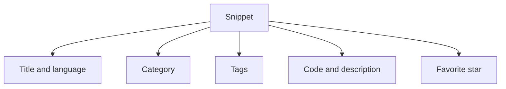
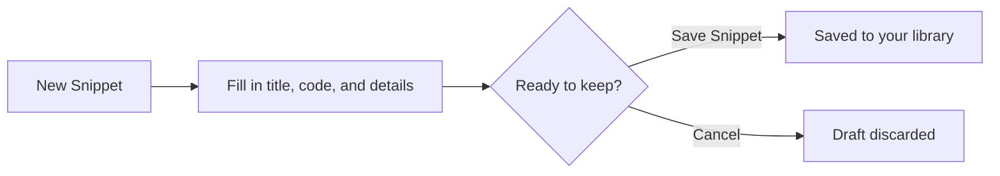

# Key concepts and terminology

CodeKnit uses a small set of everyday concepts to keep your code and Markdown snippets organized. This glossary defines the terms you will encounter as you browse the app and read the other guides.

> [!NOTE]
> Your workspace is saved on this device, in the browser. Nothing leaves your machine unless you export it.

## Snippet

A snippet is a saved unit of code or Markdown text that you want to keep and reuse. Every snippet has:

- **Title** – a required name, such as “Debounce utility”
- **Language** – the programming or markup language of the snippet
- **Code** – the actual text or code, also required
- **Category** – a top-level folder for grouping snippets
- **Tags** – optional labels for finer organization
- **Description** – optional notes about what the snippet does
- **Favorite** – an optional star marker for quick access

When you view a snippet card, you see its title, language, category, tags, a preview of its code, and its update time. A copy count appears after you have copied the snippet at least once.

See [Snippet Library](doc:9f431e10-b005-4cc0-80b1-0af4acdcb3d8) or [Your First Snippet – Quick Start](doc:72dab710-31b9-4980-becf-be9fbd6d4d94).

## Language

The language is the programming or markup format of a snippet. CodeKnit supports four options:`JavaScript`,`Python`,`SQL`, and`Markdown`.

Language controls the syntax highlighting and the colored language badge shown on each snippet card. You choose a language when you create or edit a snippet, and you can filter your library by language from the sidebar.

See [Syntax Highlighting](doc:0cc5fd84-0d94-4faf-ab51-00f580e726a4).

## Tag

A tag is a short, user-defined label that starts with`#`. Examples include`#utils` and`#regex`. Tags make snippets easier to find within a category.

A snippet can have multiple tags, and tags appear as rounded pills on snippet cards. You can filter the library to show only snippets with a particular tag by using the **Tag** filter.

See [Snippet Organization](doc:8367ddb8-1051-4848-a093-3b4352805aa4) and [Search and Filter](doc:3704cb56-cf68-421d-9db0-d3816a8af756).

## Category

A category is a top-level folder for organizing snippets. The app includes built-in categories such as`Utilities`, and you can create your own category when creating or editing a snippet.

Categories appear in the sidebar under **Categories**, with a count for each. Selecting a category filters the library to that folder. Categories are useful for broad separation, such as utilities, SQL queries, or Markdown notes.

Figure: How a snippet is organized

See [Snippet Organization](doc:8367ddb8-1051-4848-a093-3b4352805aa4).

## Favorite

A favorite is a snippet marked with a star for quick access. You can star any snippet by selecting the star icon on its card, or by turning on **Mark as favorite** when creating or editing a snippet.

Favorited snippets appear in the **Favorites** section of the sidebar, and the Dashboard shows the total number of favorites.

See [Favorites](doc:b66c5560-9b68-42eb-922d-a8aecab0dfcb).

## Draft

A draft is the unsaved work you have while the **New snippet** or **Edit snippet** dialog is open. As you type a title, code, tags, or other details, those changes exist only as a draft.

Your draft becomes a saved snippet only when you select **Save Snippet**. If you select **Cancel**, the changes are discarded.

Figure: Draft-to-saved flow

## Layout

Layout is the view mode for your snippet library: **Grid view** or **List view**.

- **Grid view** shows snippets as cards arranged in columns.
- **List view** shows snippets in a single vertical list, with the code preview next to the details.

Use the layout toggle at the top of the library to switch views. CodeKnit remembers your choice on this device.

## Dashboard

The Dashboard is the home screen that summarizes your library at a glance. It shows three stat cards:

- **Total snippets** – the number of snippets in your library
- **Favorites** – how many snippets are starred for quick access
- **Languages** – the number of distinct languages used across your snippets

The Dashboard also shows **Your Snippets**, a quick view of your saved snippets.

See [Dashboard](doc:0cccb845-62f3-4e2b-b0ca-c7d768eaf700).

## Related terms

- **Library** – the entire collection of snippets you have saved.
- **Recently Added** – the newest snippets in your library, shown in the sidebar.
- **Recently Used** – snippets you have copied, ordered by most recent copy.
- **Filter** – a control that narrows displayed snippets by language, category, or tag.
- **Search** – a text box for matching terms in snippet titles, tags, or code.

## Related

- [Product Overview](doc:ca8f433d-53d1-475b-a3a5-29b24f1ba173)
- [Snippet Library](doc:9f431e10-b005-4cc0-80b1-0af4acdcb3d8)
- [Snippet Organization](doc:8367ddb8-1051-4848-a093-3b4352805aa4)
- [Search and Filter](doc:3704cb56-cf68-421d-9db0-d3816a8af756)
- [Favorites](doc:b66c5560-9b68-42eb-922d-a8aecab0dfcb)
- [Dashboard](doc:0cccb845-62f3-4e2b-b0ca-c7d768eaf700)
