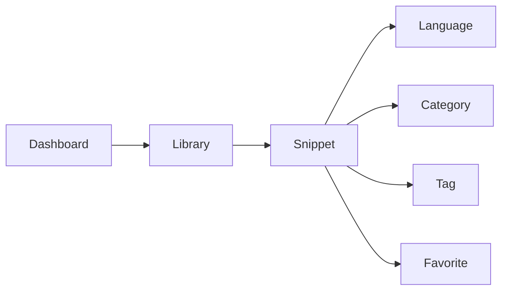

# Key concepts and terminology

CodeKnit is a snippet manager for saving and reusing code and Markdown text. This page defines the key terms you will see throughout the documentation and product.

## Core concepts

### Snippet

A snippet is a saved piece of code or Markdown text that you want to reuse. Every snippet has a **title**, a **language**, and its actual **content**. You can also add an optional **description**, assign one **category**, and attach any number of **tags**. Snippets are stored in your browser on the current device, so your library stays private unless you choose to export it.

### Language

The language tells CodeKnit how to highlight the text in a snippet. CodeKnit supports four languages:

- **JavaScript**
- **Python**
- **SQL**
- **Markdown**

You choose the language when you create or edit a snippet. The language appears on each snippet card as a colored badge and is one of the filters you can use to narrow your library.

### Tag

A tag is a short label you create to organize snippets beyond their category. Tags always appear with a`#` prefix, such as`#utils` or`#regex`. One snippet can have multiple tags, and the same tag can apply to snippets in different categories. You can filter by tag from the search and filter bar.

### Category

A category is a top-level grouping for related snippets, such as **Utilities**, **Templates**, or **Documentation**. Each snippet belongs to exactly one category. Categories appear in the left sidebar under **Categories**, with a count showing how many snippets each one contains. You can select a category from a preset list or create your own.

### Favorite

A favorite is a snippet you have marked with a star for quick access. Favoriting a snippet does not move it; it simply adds it to the **Favorites** view in the sidebar. You can star or unstar a snippet from its card or its detail view.

## Interface terms

### Layout

Layout describes how the snippet library is displayed on screen. You can switch between two layout modes:

- **Grid view**, snippets appear side by side in a responsive grid
- **List view**, snippets appear in a single column with the preview next to the details

Use the grid and list buttons in the toolbar above the snippets to change your preference. CodeKnit remembers your listed layout choice for next time.

### Dashboard

The Dashboard is the home screen you see when you first open CodeKnit. It shows a summary of your library through three stat cards: **Total snippets**, **Favorites**, and **Languages**. Below the stats, the Dashboard presents your most recent snippets so you can jump back into your work.

## Understanding drafts

### Draft

A draft is any change you have typed but not yet saved. While the snippet form is open, your edits exist only in that form. Selecting **Save Snippet** writes them to your library. Selecting **Cancel** or closing the form discards those unsaved changes.

Figure: How CodeKnit concepts connect

> [!NOTE]
> Your snippets live only in the browser where you created them. Later you can export them as a backup or to move them to another device.

## Related

- [Product Overview](doc:ca8f433d-53d1-475b-a3a5-29b24f1ba173)
- [Your First Snippet – Quick Start](doc:72dab710-31b9-4980-becf-be9fbd6d4d94)
- [Snippet Library](doc:9f431e10-b005-4cc0-80b1-0af4acdcb3d8)
- [Snippet Organization](doc:8367ddb8-1051-4848-a093-3b4352805aa4)
- [Favorites](doc:b66c5560-9b68-42eb-922d-a8aecab0dfcb)
- [Dashboard](doc:0cccb845-62f3-4e2b-b0ca-c7d768eaf700)
