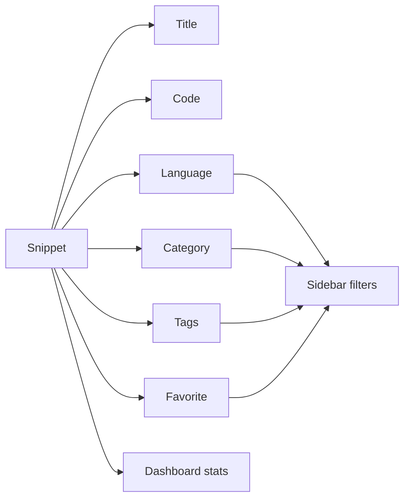

# Key concepts and terminology

CodeKnit helps you save, organize, and reuse code and Markdown snippets. This page defines the terms you will see throughout the product and its documentation.

## Snippet

A **snippet** is a saved unit of code or Markdown text. Each snippet has:

- A **title** that identifies it
- The **code** or Markdown content itself
- A **language** that tells CodeKnit how to color the code
- An optional **description**
- An optional **category** and one or more **tags**
- A **favorite** marker
- Automatic dates showing when it was created and last updated
- A copy count that tracks how many times you copied its content

You create and edit snippets using the **New Snippet** or **Edit snippet** dialog. Snippets appear as cards in your library and can be opened in a detail view.

## Language

A **language** is the programming or markup language of a snippet. CodeKnit supports four languages:

- JavaScript
- Python
- SQL
- Markdown

The language choice controls syntax highlighting in the editor and on snippet cards. You select the language when creating or editing a snippet, and you can filter the sidebar or the filter bar by language. Each language has a colored dot in the sidebar to help you spot it quickly.

## Tag

A **tag** is a user-defined label that starts with`#`. For example:`#utils`,`#regex`,`#snippets`. Tags help you organize and filter snippets in your library.

You add tags when creating or editing a snippet. Tags appear as rounded`#tag` badges on snippet cards and in the detail view. The filter bar and sidebar allow you to pick a tag to show only snippets with that tag.

## Category

A **category** is a top-level organizational folder for snippets. Categories group related snippets together, such as **Utilities**, **Templates**, or **Documentation**.

Each snippet belongs to one category. Categories appear in the sidebar with a folder icon and the number of snippets in each. When creating or editing a snippet, you can choose an existing category or create a custom one. The filter bar also lets you filter by category.

## Favorite

A **favorite** is a snippet you mark with a star for quick access. The star icon appears on every snippet card and in the detail view.

Marking a snippet as a favorite adds it to the **Favorites** section in the sidebar. You can remove the star at any time. The dashboard shows the total number of favorites in your library.

## Draft

A **draft** refers to unsaved changes in the editor. When you open **New Snippet** or **Edit snippet** and type content, those changes are not saved until you click **Save Snippet**. If you close the dialog without saving, the draft is discarded.

CodeKnit does not keep a separate drafts list. A draft is simply the in-progress content that exists only while the dialog is open and unsaved.

## Layout

**Layout** is the view mode for displaying your snippet library. CodeKnit offers two layouts:

- **Grid view**, snippets appear as cards in a multi-column grid
- **List view**, snippets appear in a single-column list with more horizontal space

You can switch between grid and list using the layout toggle icons in the filter bar. Your chosen layout is remembered the next time you open CodeKnit.

## Dashboard

The **Dashboard** is the home screen in CodeKnit. It appears when you open the product or select **Dashboard** in the sidebar.

The dashboard shows summary statistics about your library:

- **Total snippets**, the number of snippets in your library
- **Favorites**, how many snippets are starred for quick access
- **Languages**, the distinct languages used across your snippets

The dashboard also shows a preview of your snippets and access to the search and filter tools.

## How these concepts work together

Figure: How CodeKnit organizes and displays your snippets

When you create a snippet, you give it a title, code, language, and optionally a category and tags. You can mark it as a favorite. The dashboard summarizes how many snippets you have, how many favorites, and which languages you use. The sidebar and filter bar let you narrow your library by language, category, tag, or favorite status.

## Related

- [Product Overview](doc:ca8f433d-53d1-475b-a3a5-29b24f1ba173)
- [Snippet Library](doc:9f431e10-b005-4cc0-80b1-0af4acdcb3d8)
- [Snippet Organization](doc:8367ddb8-1051-4848-a093-3b4352805aa4)
- [Search and Filter](doc:3704cb56-cf68-421d-9db0-d3816a8af756)
- [Dashboard](doc:0cccb845-62f3-4e2b-b0ca-c7d768eaf700)
- [Your First Snippet – Quick Start](doc:72dab710-31b9-4980-becf-be9fbd6d4d94)
