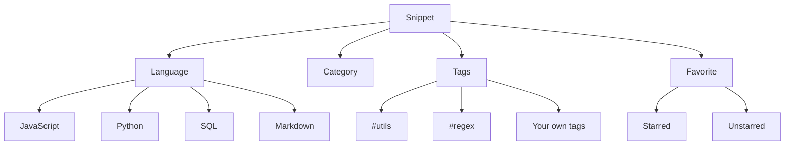
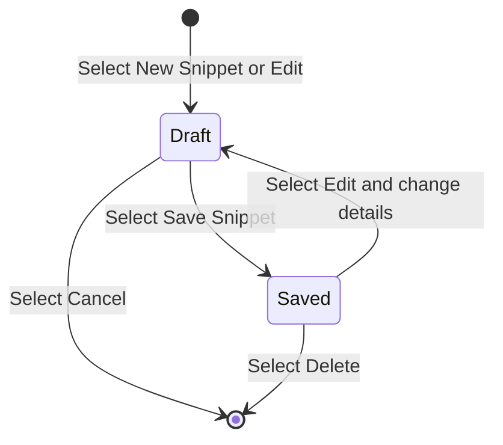

# Key concepts and terminology

CodeKnit is a snippet manager for saving, organizing, and reusing pieces of code and Markdown. This page defines the terms you'll see throughout the app so you can build and navigate your library consistently. For a broad introduction, see the [Product Overview](doc:ca8f433d-53d1-475b-a3a5-29b24f1ba173).

## How the concepts fit together

Every saved item is a snippet. Each snippet has exactly one language and one category, and can carry any number of tags. You can also mark a snippet as a favorite for fast access.

Figure: Snippet organization model

## Core concepts

### Snippet

A saved unit of code or Markdown text. Each snippet includes:

- A **title**
- An optional **description**
- A **language**
- A **category**
- Optional **tags**
- The **code** or Markdown text itself

Snippets also track when they were created and last updated, how many times they've been copied, and when they were last copied. You can create your first snippet by following the [Quick Start](doc:72dab710-31b9-4980-becf-be9fbd6d4d94) guide, or learn more about the [Snippet Library](doc:9f431e10-b005-4cc0-80b1-0af4acdcb3d8).

### Language

The programming or markup language a snippet contains. CodeKnit supports four languages:

- JavaScript
- Python
- SQL
- Markdown

Each language has a colored dot in the sidebar. The language controls how lines of code are colorized in the editor and preview, as described in [Syntax Highlighting](doc:0cc5fd84-0d94-4faf-ab51-00f580e726a4).

### Tag

A short, user-defined label that starts with`#`. Tags are optional and help you group related snippets across categories. Examples include`#utils`,`#regex`, or any label that makes sense to you. You add tags when you create or edit a snippet, and you can then filter the library by a single tag. The same tag can appear on many snippets.

### Category

A top-level folder that groups snippets by purpose or type. Every snippet belongs to one category. CodeKnit includes built-in categories such as **Utilities**, and you can add your own custom category when creating or editing a snippet. Categories appear in the sidebar with the number of snippets in each one. See [Snippet Organization](doc:8367ddb8-1051-4848-a093-3b4352805aa4) for more.

### Favorite

A snippet marked with a star for quick access. You can favorite or unfavorite a snippet from its card or from the detailed view. The **Favorites** section in the sidebar shows all starred snippets. See [Favorites](doc:b66c5560-9b68-42eb-922d-a8aecab0dfcb).

### Layout

The view mode for your snippet collection: **grid** or **list**.

- Grid shows cards side by side, one, two, or three columns depending on your screen width.
- List shows a single column, with the code preview beside the snippet details on wider screens.

CodeKnit remembers your layout choice between visits.

### Dashboard

The home screen of CodeKnit. It shows the heading **Your code, organized.** along with three summary cards:

- Total snippets in your library
- Number of favorites
- Number of distinct languages used

For more details, see the [Dashboard](doc:0cccb845-62f3-4e2b-b0ca-c7d768eaf700) page.

### Draft: unsaved changes

When you create or edit a snippet, your changes are not saved until you select **Save Snippet**. If you close the form without saving, those changes are discarded. The form deliberately stays open if you click outside it, so an accidental click won't lose your work.

Figure: Snippet saving flow

### Recently added and recently used

The sidebar includes two time-based sections in addition to **Dashboard**, **All Snippets**, and **Favorites**:

- **Recently Added** shows up to 10 of your newest snippets.
- **Recently Used** shows snippets ordered by when you last copied them; snippets you have never copied don't appear here.

## Using these concepts together

You can narrow what's shown by using the search box and the filter controls: a **language filter**, a **category filter**, a **tag filter**, and a **sort** option (**Recently Added**, **Oldest First**, or **A–Z**). When one or more filters are active, a **Clear Filters** button appears so you can reset them. The sidebar's **Categories** and **Languages** groups also let you jump directly to a single category or language. For step-by-step guidance, see [Search and Filter](doc:3704cb56-cf68-421d-9db0-d3816a8af756).

## Related

- [Product Overview](doc:ca8f433d-53d1-475b-a3a5-29b24f1ba173)
- [Snippet Library](doc:9f431e10-b005-4cc0-80b1-0af4acdcb3d8)
- [Snippet Organization](doc:8367ddb8-1051-4848-a093-3b4352805aa4)
- [Search and Filter](doc:3704cb56-cf68-421d-9db0-d3816a8af756)
- [Favorites](doc:b66c5560-9b68-42eb-922d-a8aecab0dfcb)
- [Dashboard](doc:0cccb845-62f3-4e2b-b0ca-c7d768eaf700)
