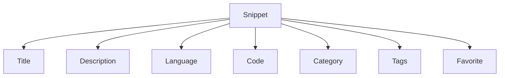
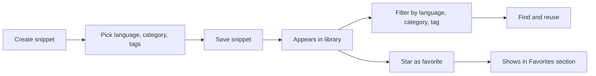

# Key concepts and terminology

CodeKnit is built around a few simple ideas. Understanding these terms will help you organize your snippets, find them quickly, and follow along with other guides.

## The anatomy of a snippet

A snippet is more than just the code you save. It carries a title, a language, a category, optional tags, and a favorite status. The diagram below shows what makes up a snippet.

Figure: What makes up a snippet

## Core concepts

### Snippet
A snippet is a saved piece of code or Markdown text that you want to keep and reuse. Each snippet includes a **title**, an optional **description**, the content itself, a **language**, a **category**, and any **tags** you choose. You can also mark a snippet as a **favorite**.

From your library, you can view, edit, copy, or delete any snippet. Snippets are the building blocks of your CodeKnit workspace. To learn more about working with the snippet library, see [Snippet Library](doc:9f431e10-b005-4cc0-80b1-0af4acdcb3d8).

### Language
The language is the programming or markup language of a snippet. CodeKnit supports four languages:

- JavaScript
- Python
- SQL
- Markdown

The language you choose affects how your code is colorized in the editor and preview. You can also filter your library by language using the sidebar or the filter bar. For details on how highlighting works, see [Syntax Highlighting](doc:0cc5fd84-0d94-4faf-ab51-00f580e726a4).

### Tag
A tag is a short label you create to organize snippets. Tags appear with a`#` prefix, for example,`#utils` or`#regex`. You can add multiple tags to a single snippet when creating or editing it.

Tags make it easy to group related snippets across different categories. You can filter snippets by tag using the **Tag** filter in the filter bar. Learn more about organizing with tags and categories in [Snippet Organization](doc:8367ddb8-1051-4848-a093-3b4352805aa4).

### Category
A category is a top-level folder that groups related snippets. Every snippet belongs to exactly one category. CodeKnit includes default categories such as **Utilities**, and you can create your own custom categories when needed.

Categories appear in the sidebar with a folder icon and a count of how many snippets are in each. You can filter your library by category from the sidebar or the filter bar.

### Favorite
A favorite is a snippet you have starred for quick access. Favorites appear in a dedicated **Favorites** section in the sidebar, so you can reach your most-used snippets without searching.

You can toggle the favorite star from a snippet card or when viewing a snippet in detail. The number of favorites in your library is shown on the **Dashboard**. To explore this feature, see [Favorites](doc:b66c5560-9b68-42eb-922d-a8aecab0dfcb).

### Draft
A draft is the unsaved state of a snippet while you are creating or editing it. Your changes are not saved until you click **Save Snippet**. If you close the form without saving, your changes are lost.

CodeKnit does not keep drafts automatically, so remember to save before you navigate away. While editing, the editor shows your current content, but it is only stored after you save.

### Layout
Layout describes how your snippet library is displayed on screen. You can choose between two view modes:

- **Grid view**, snippets appear as cards in a multi-column layout
- **List view**, snippets appear in a single column with a wider preview

Use the layout toggle in the filter bar to switch between **Grid view** and **List view**. CodeKnit remembers your choice for the next time you open the app.

### Dashboard
The Dashboard is the home screen you see when you first open CodeKnit. It greets you with “Your code, organized.” and shows summary statistics about your library:

- **Total snippets**, how many snippets you have saved
- **Favorites**, how many snippets you have starred
- **Languages**, how many different languages are used in your snippets

The Dashboard also displays a list of your snippets below the statistics. To learn more about what the Dashboard offers, see [Dashboard](doc:0cccb845-62f3-4e2b-b0ca-c7d768eaf700).

## How the concepts fit together

When you create a snippet, you choose a **language**, assign a **category**, and optionally add **tags** and mark it as a **favorite**. These choices determine where the snippet appears in the sidebar and how easily you can find it later.

- **Categories** and **languages** appear as filter options in the sidebar.
- **Tags** appear in the filter bar and on each snippet card.
- **Favorites** get their own sidebar section.
- The **layout** you choose changes how snippets are displayed, but not their content.
- The **Dashboard** summarizes everything at a glance.

The diagram below shows this relationship in a simple flow.

Figure: How snippet properties help you find things

## Related

- [Product Overview](doc:ca8f433d-53d1-475b-a3a5-29b24f1ba173)
- [Snippet Library](doc:9f431e10-b005-4cc0-80b1-0af4acdcb3d8)
- [Snippet Organization](doc:8367ddb8-1051-4848-a093-3b4352805aa4)
- [Favorites](doc:b66c5560-9b68-42eb-922d-a8aecab0dfcb)
- [Search and Filter](doc:3704cb56-cf68-421d-9db0-d3816a8af756)
- [Dashboard](doc:0cccb845-62f3-4e2b-b0ca-c7d768eaf700)
