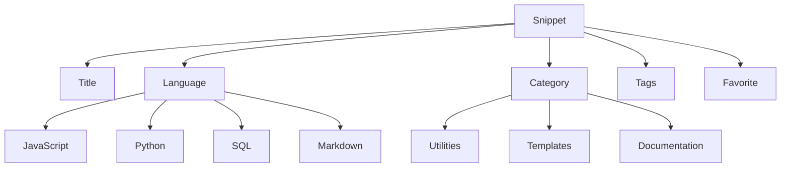

# Key concepts and terminology

This page defines the core terms you will encounter throughout CodeKnit and its documentation. Understanding these concepts helps you organize, find, and reuse your snippets effectively. For a quick introduction to the product, see [Product Overview](doc:ca8f433d-53d1-475b-a3a5-29b24f1ba173).

The diagram below shows how a snippet relates to the main organizing concepts.

Figure: How a snippet connects to language, category, tags, and favorites

## Snippet

A snippet is a saved unit of code or Markdown text that you want to keep and reuse. Every snippet has:

- A **title**
- An optional **description**
- A **language**
- The **code** or Markdown content
- A **category**
- One or more optional **tags**
- A **favorite** status (starred or not)

Snippets are displayed as cards in the library. Each card shows the title, language, category, tags, and a preview of the code. You create snippets by selecting **New Snippet** and filling in the form. Learn more in [Snippet Library](doc:9f431e10-b005-4cc0-80b1-0af4acdcb3d8) and [Snippet Organization](doc:8367ddb8-1051-4848-a093-3b4352805aa4).

## Language

The language is the programming or markup language of a snippet. CodeKnit supports four languages:

- JavaScript
- Python
- SQL
- Markdown

Each language has a colored dot next to its name in the sidebar, helping you spot languages at a glance. The editor and preview adjust their syntax highlighting based on the snippet's language.

## Category

A category is a top-level organizational folder for your snippets, such as Utilities, Templates, or Documentation. Categories help you group related snippets and are listed in the sidebar with a count of how many snippets each one contains.

You can choose an existing category when creating or editing a snippet, or create a custom category by selecting **+ Custom category…** in the category dropdown. Learn more in [Snippet Organization](doc:8367ddb8-1051-4848-a093-3b4352805aa4).

## Tag

A tag is a user-defined label prefixed with`#` (for example,`#utils` or`#regex`). Tags provide a flexible way to organize and filter snippets across categories. A snippet can have multiple tags.

Tags appear as small, rounded chips on snippet cards. You can filter the library by tag using the **Tag filter** in the filter bar. Learn more in [Snippet Organization](doc:8367ddb8-1051-4848-a093-3b4352805aa4).

## Favorite

A favorite is a snippet marked with a star for quick access. Starring a snippet adds it to the **Favorites** section in the sidebar, so you can find it without searching through the entire library.

You can star or unstar a snippet in three places:

1. Hover over a snippet card and select the star icon.
2. Open the snippet detail view and select **Favorite** or **Favorited**.
3. Turn on the **Mark as favorite** switch in the snippet form.

On snippet cards, a favorited snippet shows a filled star. Learn more in [Favorites](doc:b66c5560-9b68-42eb-922d-a8aecab0dfcb).

## Draft

A draft is the unsaved work in the snippet form while you are creating or editing a snippet. While the **New Snippet** or **Edit Snippet** dialog is open, your changes are temporary and are not yet part of the library.

To save a draft, select **Save Snippet**. To discard your changes, select **Cancel**. CodeKnit protects drafts by preventing the dialog from closing when you click outside it, so you won't accidentally lose unsaved work.

## Layout

Layout is the view mode for displaying your snippet library. CodeKnit offers two layouts:

- **Grid view**, snippets appear as cards in columns
- **List view**, snippets appear as full-width rows with a wider code preview

Use the layout toggle in the filter bar to switch between views. Your chosen layout is remembered on your device the next time you open CodeKnit.

## Dashboard

The Dashboard is the home screen of CodeKnit. It shows a summary of your snippet library at a glance:

- **Total snippets**, the total number of snippets in your library
- **Favorites**, how many snippets are starred
- **Languages**, how many different languages are in use, with a hint listing them

Below the summary, the Dashboard shows your most recent snippets under **Your Snippets**. Learn more in [Dashboard](doc:0cccb845-62f3-4e2b-b0ca-c7d768eaf700).

## Related terms

Other common terms appear throughout the documentation:

- **Search query**, the text you type in the search box to match snippet titles, tags, or code
- **Filter**, a control that narrows the library by language, category, tag, or favorites
- **Sort**, the ordering of results: Recently Added, Oldest First, or A–Z
- **Copy count**, how many times a snippet's code has been copied

For details on finding snippets, see [Search and Filter](doc:3704cb56-cf68-421d-9db0-d3816a8af756).
