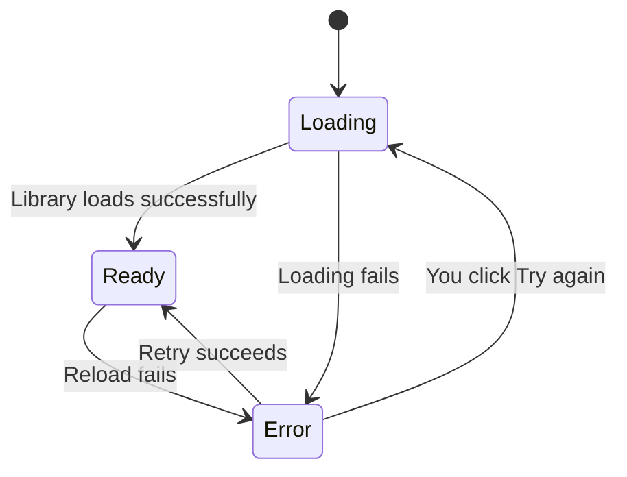
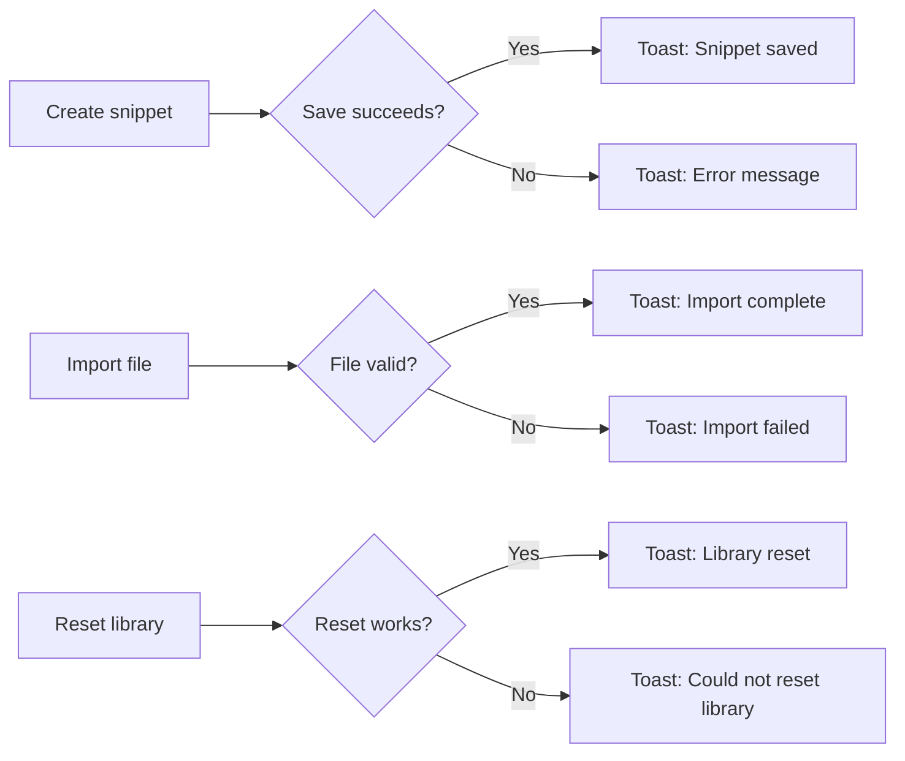

# Logging and diagnostics

CodeKnit keeps you informed about what's happening behind the scenes. When your snippet library loads, runs into trouble, or successfully saves an action, the app shows clear status messages, progress indicators, and error details so you always know where things stand.

## Who this is for

This is for anyone using CodeKnit, but especially helpful when something goes wrong and you need to understand why. Developers troubleshooting a failed import or investigating a library that won't load will find the error text and recovery options useful.

## Core diagnostics you'll see

### Library loading progress

When you open CodeKnit, your snippet library needs to be read from your browser's local storage. During this time, the app shows three gray placeholder cards in place of your snippets. Once loading finishes, your actual snippet cards replace the placeholders automatically.

### Error alert with recovery

If your snippet library can't be loaded, CodeKnit replaces the content area with a dedicated error panel. It shows:

- A warning icon
- The message **Couldn't load your snippets** followed by the specific error detail
- A **Try again** button that re-attempts loading without refreshing the page

Figure: Snippet library loading flow

## Operation notifications

Every significant action you take provides instant feedback through a small toast message that appears on screen and then disappears.

### Success messages

When an operation completes, you'll see messages such as:

- **Snippet saved** after creating a new snippet
- **Snippet updated** after editing an existing snippet
- **Snippet deleted** after removing a snippet
- **Exported snippets** after downloading a backup, with the number of snippets included
- **Import complete** after merging a backup file, with the count of imported and skipped duplicates
- **Library reset** after restoring sample data

### Error messages

When an operation fails, you'll see an error toast with a specific reason. Examples include:

- **Import failed** with a description of what couldn't be read from the file
- **Could not reset library** with a reason if sample data can't be restored
- Error text from a failed save or delete action

### Informational messages

Some messages simply give you useful context:

- **No new snippets imported** appears when you import a backup that contains only duplicates

Figure: Operation feedback paths

## What diagnostics cover

The feedback system covers these activities:

- Initial library loading and any failures
- Creating, editing, and deleting snippets
- Exporting your snippet library
- Importing a backup file
- Resetting to sample data
- Toggling favorites

## Related

- [Dashboard](doc:0cccb845-62f3-4e2b-b0ca-c7d768eaf700), see the home screen where library status is displayed
- [Snippet Library](doc:9f431e10-b005-4cc0-80b1-0af4acdcb3d8), understand where snippets are stored and retrieved
- [Import and Export](doc:f1b42dc6-1597-47d7-b921-658815f5af20), learn how backups and merges work
- [Product Overview](doc:ca8f433d-53d1-475b-a3a5-29b24f1ba173), see how CodeKnit fits together
