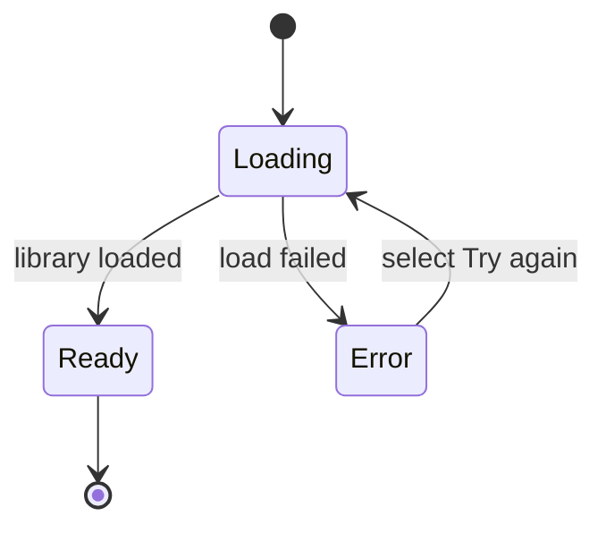
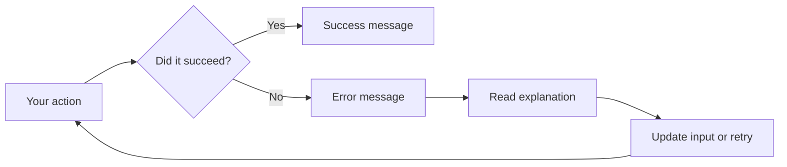

# Logging and diagnostics

CodeKnit gives you consistent, easy-to-read feedback wherever you work. Instead of leaving you guessing whether an action succeeded, the app uses brief notifications, progress indicators, inline hints, and confirmation prompts so you always know what happened and what to do next.

## Who it's for

This feature is for developers who save, organize, and reuse code snippets in CodeKnit. If you manage a personal snippet library, you'll see progress and error messages during everyday actions such as loading the library, saving a snippet, deleting it, importing a backup, or exporting a JSON file.

## What to expect

CodeKnit reports status in four main ways:

- **Progress indicators** show that an operation is still running.
- **Success messages** confirm that an action completed.
- **Error messages** explain what went wrong and often suggest a fix.
- **Confirmation prompts** protect you from accidental, unrecoverable actions.

Figure: How CodeKnit responds to a snippet library load

## Status updates and progress

### Loading the library

When you open CodeKnit and your snippets are still loading, the main area shows three grey placeholder cards instead of a blank page. Once loading finishes, the placeholders are replaced by your real snippet cards.

### Saving a snippet

When you save a new snippet or update an existing one:

1. The **Save Snippet** button becomes disabled.
2. The button text changes to **Saving…**.
3. When the operation completes, a brief confirmation appears.

If saving takes longer than expected, stay on the form. The disabled button is your signal that CodeKnit is still working.

### Importing a JSON backup

While CodeKnit processes an import file, the **Import JSON** button changes to **Importing…** and becomes disabled. This prevents you from triggering the same import twice before the first one finishes.

## Success messages

After these actions complete, CodeKnit shows a short confirmation:

- **Snippet saved** when you create a new snippet
- **Snippet updated** when you edit an existing snippet
- **Snippet deleted** when you remove a snippet
- **Exported snippets** along with the number of snippets downloaded
- **Import complete** with the number of snippets imported and how many duplicates were skipped
- **Library reset** when you restore the sample data

## Error messages

When something fails, CodeKnit explains what happened instead of failing silently.

### Library load errors

If your snippet library cannot be loaded, an error panel appears in the main content area. It shows a warning icon and the message **Couldn't load your snippets**, followed by the specific problem. A **Try again** button lets you retry the load without refreshing the page.

### Save errors

If a snippet cannot be saved, an error message appears with either a specific reason or the fallback text **Couldn't save the snippet**. Correct the highlighted form field or try again.

### Import and export errors

- If an import file is invalid, you see **Import failed** with a description explaining what went wrong.
- If a file cannot be read, you see **Could not read this file.**
- If an export fails, check whether your browser allows downloads from the current page and try again.

### Delete errors

If a snippet cannot be removed, an error message appears with the reason. Your snippet remains in the library.

### Favorite and copy tracking errors

Marking a snippet as a favorite or recording a copy normally happens instantly. If either action fails, a brief error message appears with the specific problem. Your other actions are not affected.

## Validation feedback

The snippet form checks required fields before saving. If a required field is empty, CodeKnit shows inline help directly beneath that field and prevents the save:

- **Title**, shows **Title is required.**
- **Code**, shows **Code is required.**
- **Category**, shows **Enter a category name.**

You can correct the field immediately and submit again. These inline hints appear only after you attempt to save with missing information.

## Confirmation prompts

Some actions are permanent. CodeKnit asks you to confirm before proceeding.

### Deleting a snippet

Before a snippet is removed, a dialog appears with the title **Delete this snippet?** and a description stating that the snippet will be permanently removed and that the action cannot be undone. You can select **Cancel** to keep it or **Delete** to confirm.

> [!WARNING]
> Deleting a snippet cannot be undone. Confirm only when you are sure you no longer need it.

### Resetting to sample data

In **Settings**, the **Reset** option follows a two-step safeguard:

1. Select **Reset** once. The button changes to **Confirm reset**.
2. Select **Confirm reset** to proceed.

> [!WARNING]
> Resetting the library replaces all your snippets with sample data. Your existing snippets are removed.

Figure: Feedback path for an action you take in CodeKnit

## Limits

- Success and error notifications are brief and disappear on their own. CodeKnit does not keep a persistent message history.
- The library load error panel is the only full-page status screen. Most other feedback appears as a small inline message.
- You cannot undo a delete or a reset after confirming. Use the confirmation dialogs as your final check.

## Related

- [Import and Export](doc:f1b42dc6-1597-47d7-b921-658815f5af20)
- [Snippet Library](doc:9f431e10-b005-4cc0-80b1-0af4acdcb3d8)
- [Code Editor](doc:a1109ff6-5fe7-437a-99ec-4d0b442bb0fd)
- [Product Overview](doc:ca8f433d-53d1-475b-a3a5-29b24f1ba173)
