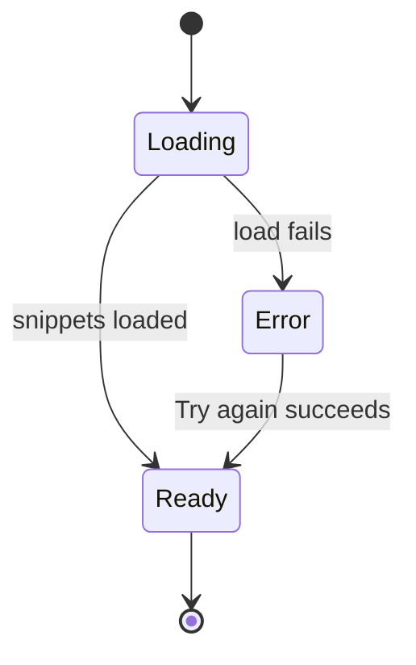
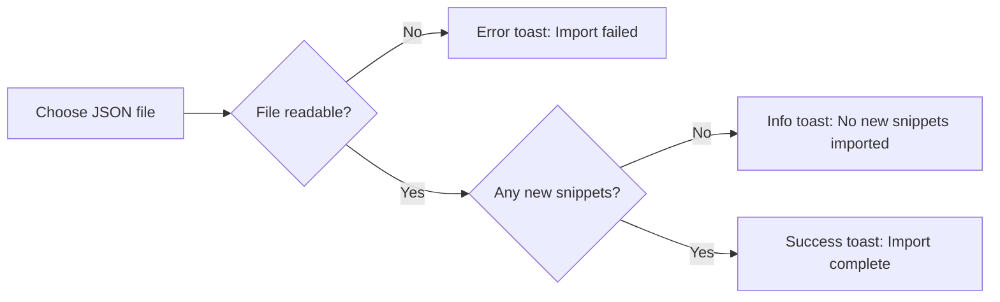
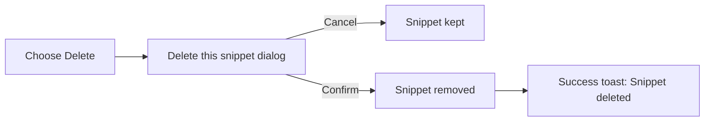

# Logging and diagnostics

Logging & Diagnostics explains how CodeKnit reports status, errors, and confirmation messages while you work with your snippet library. Instead of leaving you guessing, CodeKnit shows what happened, what went wrong, and what you can do next.

## Who it's for

Logging & Diagnostics is for anyone who uses CodeKnit to manage snippets. It is especially useful when you are importing a backup, resetting your library, or troubleshooting a problem, because CodeKnit explains exactly what occurred and how many items were affected. Developers who manage code snippets benefit most from the detailed import and export messages.

## What it does

CodeKnit provides feedback in three main ways:

- **Status indicators** show whether your library is still loading, ready to use, or failed to load.
- **Toast messages** appear briefly with success, error, or informational text after actions such as saving, deleting, exporting, and importing.
- **Validation messages** appear directly under form fields that need your attention.

These messages help you confirm actions, understand failures, and recover quickly.

## Library loading status

When you open CodeKnit, your snippet library goes through one of three states:

- **Loading**, placeholder skeleton cards appear while your snippets are being retrieved.
- **Ready**, your snippet cards display normally.
- **Error**, if the library cannot be loaded, an alert panel appears with the specific error message and a **Try again** button.

The **Try again** button reloads your library without requiring a page refresh. If the problem was temporary, your snippets appear normally after you select it.

Figure: Library loading status flow

## Toast messages

After you complete most actions, CodeKnit shows a brief toast message at the edge of the screen. Toasts confirm success, explain errors, and provide context such as how many items were affected.

Common success messages include:

- **Snippet saved**
- **Snippet updated**
- **Snippet deleted**
- **Exported snippets**
- **Import complete**
- **Library reset**

Common error messages include:

- **Import failed**
- **Could not reset library**
- **Couldn't save the snippet**

When you import snippets, CodeKnit also shows an informational message if nothing new was added:

- **No new snippets imported**

## Import and export diagnostics

The import and export actions provide the most detailed diagnostics in CodeKnit.

When you export your library, CodeKnit confirms the action and tells you how many snippets were downloaded to the JSON file.

When you import a JSON file, CodeKnit validates the file first, then reports one of three outcomes:

- If the file cannot be read or parsed, CodeKnit shows **Import failed** with the reason.
- If all snippets in the file already exist in your library, CodeKnit shows **No new snippets imported** and tells you how many duplicates were skipped.
- If some snippets are new, CodeKnit shows **Import complete** and reports how many were imported and how many duplicates were skipped.

Figure: Import result feedback

## Form validation

When you create or edit a snippet, CodeKnit checks three required fields before saving:

- **Title**, required
- **Code**, required
- **Category**, must have a name

If a required field is empty, CodeKnit shows a red validation message directly under that field. The form does not submit until you correct the problem. Each message states exactly which field needs attention, such as **Title is required** or **Code is required**.

> [!NOTE]
> Validation messages clear automatically once you enter valid content in the field.

## Delete confirmation for destructive actions

Because deleting a snippet is permanent, CodeKnit requires a confirmation step before removing anything.

When you select **Delete** on a snippet card or in the snippet viewer, a dialog appears with the title **Delete this snippet?** and a warning that the action cannot be undone. You can choose **Cancel** to keep the snippet or **Delete** to confirm removal. After a successful deletion, CodeKnit shows a **Snippet deleted** toast.

Figure: Delete confirmation flow

## Limits

CodeKnit does not keep a persistent log of past messages. Toasts disappear on their own after a few moments, and there is no history panel that records every action you have taken. Diagnostics are shown only for the action you are currently performing.

## Related

- [Import and Export](doc:f1b42dc6-1597-47d7-b921-658815f5af20), includes detailed import and export diagnostics
- [Snippet Library](doc:9f431e10-b005-4cc0-80b1-0af4acdcb3d8), explains how the library loads and the error state
- [Code Editor](doc:a1109ff6-5fe7-437a-99ec-4d0b442bb0fd), describes where code entry and validation occur
- [Favorites](doc:b66c5560-9b68-42eb-922d-a8aecab0dfcb), favorite toggles show error messages if they fail
