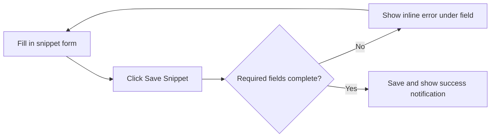
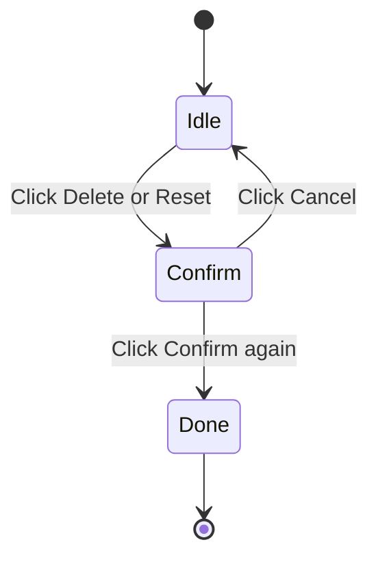

# Logging and diagnostics

This page explains how CodeKnit tells you what's happening while you work with your snippet library. It covers status messages, warnings, error messages, and the safeguards that help you avoid losing work.

## Who it's for

Logging & Diagnostics is for everyone who uses CodeKnit, but it's especially valuable when something goes wrong. You don't need any technical background to understand the messages CodeKnit shows you. The app uses plain-language notifications and inline messages to tell you when things succeed, when something needs your attention, and when an action can't be completed.

## What it does

CodeKnit gives you several types of feedback as you use the app:

- **Success messages** appear after you save, delete, export, or reset snippets
- **Error messages** appear in a red alert box when the app can't load your library, or as a notification when an operation such as an import fails
- **Inline validation** highlights missing required fields on the snippet form before you try to save
- **Warning and confirmation prompts** make you confirm before a destructive action such as deleting or resetting data
- **Progress indicators** show when your library is still loading or an import is in progress

## Benefits

- You always know whether an action succeeded or failed
- You can correct form errors before a save attempt fails
- You get a chance to cancel destructive actions such as deleting a snippet
- You can retry when your library fails to load
- Import errors explain what went wrong, so you can fix your file and try again

## Where messages appear

### Notifications (toasts)

CodeKnit uses small, temporary pop-up messages in the corner of the screen for the most common results. These are called *notifications*. A notification appears when you:

- Delete a snippet, success message with **Snippet deleted**
- Export your library, success message tells you how many snippets were downloaded
- Import snippets, success, informational, or error message with details about what was imported or skipped
- Reset your library, success message **Library reset** or an error if the reset could not finish
- Save or update a snippet, success messages **Snippet saved** and **Snippet updated**

*Error and success notifications.* Notifications disappear on their own after a few seconds. Error notifications usually stay visible long enough for you to read what went wrong.

### Inline validation

When you fill out the snippet form, CodeKnit checks required fields before saving. If you try to save without a title or without any code, you see a message directly beneath the field that needs attention, such as:

- **Title is required.**
- **Code is required.**
- **Enter a category name.**

The invalid field is also marked with a red border. You can fix the issue and save again without losing the rest of what you entered.

Figure: Form validation flow

### Load error screen

If CodeKnit can't load your snippets, the main area shows a dedicated error screen. It includes:

- A warning icon
- The text **Couldn't load your snippets** followed by the reason
- A **Try again** button so you can retry loading without reloading the whole page

While your snippets are loading, CodeKnit shows skeleton placeholders. When the load completes successfully, the placeholders are replaced by your actual snippet cards.

### Confirmation dialogs

Before performing an action that can't be undone, CodeKnit asks you to confirm.

**Delete this snippet?** The confirmation dialog shows the title of the snippet you chose to delete, warns you that it will be permanently removed, and tells you that this can't be undone. You can either click **Cancel** or **Delete**.

**Reset to sample data** The settings panel gives you a reset option that replaces all your snippets. The first click changes the button label to **Confirm reset**. Only after you click the button a second time does the reset happen. If something goes wrong during the reset, an error notification appears.

Figure: Destructive action confirmation

## Import diagnostics

When you import snippets from a JSON file, CodeKnit validates the entire file before changing your saved data. The result is one of three notification types:

- **Success**, shows how many snippets were imported and how many duplicates were skipped, for example **5 imported, 2 duplicate(s) skipped**
- **Informational**, if no new snippets were imported, the message tells you all snippets were duplicates and how many were skipped
- **Error**, if the file can't be read or has an invalid format, you see **Import failed** with a short explanation of what went wrong

Because the file is validated before import, a bad file won't damage your existing library. After an import attempt, the file picker is cleared so you can select the same file again after correcting it.

## Request progress

CodeKnit shows progress in a few places:

- **Library loading**, skeleton cards appear in the layout while your snippets are being read
- **Importing**, the import button changes to **Importing…** and is disabled while the import runs
- **Save button**, the save button in the snippet form changes to **Saving…** and is disabled while the save runs

Once the operation finishes, the button returns to its normal label and is usable again.

## Diagnostics coverage by action

| Action | What you see |
|---|---|
| Open the app | Skeleton cards while loading, error screen with retry if loading fails |
| Save a new snippet | Inline errors if required fields are missing, success notification |
| Edit a snippet | Inline errors for required fields, success notification |
| Delete a snippet | Confirmation dialog, then success notification |
| Export library | Success notification with snippet count |
| Import library | Success, skipped-duplicate, or error notification |
| Reset library | Confirm-reset button, then success notification or error |

## Limits

- Error and success notifications are temporary; they disappear automatically and can't be replayed
- If you close the app while a notification is visible, it's gone when you come back
- The load error screen tells you that loading failed, but the exact technical cause may not be visible on that screen
- Import validation protects against malformed data, but you must fix the file yourself and retry, CodeKnit doesn't repair the file for you

## Related pages

- [How to debug errors with detailed context](doc:a9ead17d-7cce-4ed8-b0e6-f8578ab70072)
- [How to receive warnings for configuration issues](doc:0343a837-0b25-4218-a962-ba9ae883f917)
- [How to view build progress and status messages](doc:1c979433-c5bf-4e10-8e5c-5a4822d74c52)
- [Import and Export](doc:f1b42dc6-1597-47d7-b921-658815f5af20)
- [Code Editor](doc:a1109ff6-5fe7-437a-99ec-4d0b442bb0fd)
