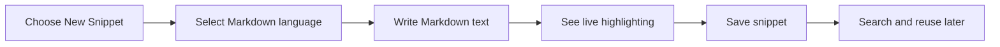

# MDX and markdown authoring

Save and reuse Markdown-formatted snippets with live syntax highlighting in your CodeKnit library. Markdown snippets get the same organization, search, filtering, favoriting, and one-click copying as code snippets, with Markdown formatting elements such as headings, bold text, and links colorized for easier reading.

> [!NOTE]
> This version supports Markdown authoring with syntax highlighting. MDX-specific features such as embedded interactive components and front matter validation are not available yet.

## Who it's for

Markdown authoring is for anyone who wants to keep reusable formatted text in their snippet library. Content authors can store documentation fragments, note templates, or standard responses. Developers can save Markdown blocks they reuse often, such as README sections, changelog entries, or API descriptions.

## What you can do

When you create or edit a snippet, you can select **Markdown** as the language. The editor then highlights Markdown formatting live as you type:

- **Headings** appear in a distinct color and bold weight
- **Bold text** stands out from surrounding text
- **Links** appear underlined and in a distinct color

A Markdown snippet can include a title, description, category, and tags, just like any other snippet. You can favorite it, copy it to your clipboard with one click, and find it later through the search and filter controls.

Figure: Creating and reusing a Markdown snippet

## How markdown snippets fit into your library

Markdown snippets appear in your library with a language badge that has its own color indicator, making them easy to spot among code snippets. You can filter the library by Markdown as a language, include Markdown snippets in category and tag views, and see them in your Recent and Favorites sections like any other saved item.

## Key options

| Option | What it does |
| --- | --- |
| **Markdown language** | Select Markdown when creating or editing a snippet to enable Markdown-aware highlighting |
| **Live highlighting** | Headings, bold text, and links are colorized as you type in the editor |
| **Markdown badge** | Shows Markdown snippets with their own color indicator in the library and detail view |
| **Reuse controls** | Copy Markdown content, favorite it, or filter by it using the same controls as code snippets |

## Current limits

- Markdown is shown with syntax highlighting, not rendered as rich text or a live preview. The editor and preview display your Markdown source, colorized for readability.
- MDX authoring is not included in this version, so you cannot embed interactive components or use MDX-specific syntax in your snippets.
- There is no front matter support or automatic validation for Markdown snippets.
- Markdown snippets do not include a built-in image handling or optimization workflow. You can still paste image paths or URLs as regular Markdown text.

## Related pages

- [Syntax Highlighting](doc:0cc5fd84-0d94-4faf-ab51-00f580e726a4)
- [Snippet Library](doc:9f431e10-b005-4cc0-80b1-0af4acdcb3d8)
- [Code Editor](doc:a1109ff6-5fe7-437a-99ec-4d0b442bb0fd)
- [Your First Snippet – Quick Start](doc:72dab710-31b9-4980-becf-be9fbd6d4d94)
