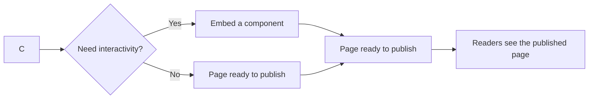

# MDX and markdown authoring

MDX & Markdown Authoring is the system you use to write rich, structured content for your documentation site. It combines plain Markdown with MDX, a format that extends Markdown with interactive components.

## Who it's for

This feature serves two audiences:

- **Content authors** write documentation pages, blog posts, and guides using Markdown. They can produce rich pages with images, diagrams, and embedded interactive elements without needing to write code.
- **Developers** create reusable components that content authors can place inside a page. Developers also configure the content pipeline, including schema validation and processing rules.

## What you can do

### Write markdown content with structured metadata

Every content file includes a front matter section at the top. Front matter stores page metadata such as the title, description, and navigation settings. This metadata controls how the page appears in search results, sidebars, and site navigation.

The system validates front matter against a schema, so mistakes are caught early—before a page reaches readers.

Learn more in [How to write Markdown content with front matter](doc:f6c3013b-eeca-4de7-9e8b-1e5ec5433170).

### Embed interactive components in MDX

With MDX, you can insert interactive components directly into a documentation page. A component can be a styled callout, a tabbed content panel, a live code example, or any other custom element that makes the page more useful.

This capability turns static documentation into an interactive experience. Readers can interact with examples, toggle between views, or explore a live demo without leaving the page.

Learn more in [How to embed interactive React components in MDX](doc:16f69fc6-4ecd-4800-97d3-3ff8f43ca685).

### Add and optimize images

Images are added using standard Markdown image syntax. The system includes image optimization and transformation, so you can resize, compress, or convert images for faster page loading without manually editing image files.

Learn more in [How to optimize and transform images](doc:95aacdcc-3fca-4d10-9764-78ae850a37f3).

### Render mermaid diagrams

Mermaid code blocks render as visual diagrams on the published page. You can create flowcharts, sequence diagrams, state diagrams, and other visuals using plain text syntax inside a fenced code block.

Learn more in [How to render Mermaid diagrams](doc:1e7891d7-ec3b-43fb-9ea5-78650c4fb27e).

### Validate content structure

The system validates front matter against a defined schema as content is processed. This means required fields like titles are checked, field values are verified to use the right format, and configuration errors are reported clearly.

Learn more in [How to validate front matter against schema](doc:b6e9bdac-0aa1-44bd-a2c2-2bea6c84b4a3).

## How authoring fits together

Figure: From content file to published page

The same authoring pipeline powers multiple areas of the product. Documentation pages, blog posts, and versioned content all use Markdown and MDX content files processed the same way.

When you write a page, you combine plain Markdown for text and structure with optional front matter for metadata. If the page needs interactivity or custom layout, you switch to MDX and embed components. Images and Mermaid diagrams integrate directly into the same content files.

## Benefits

- **Simple authoring**: plain Markdown covers most content needs without any special syntax
- **Extensible when needed**: MDX lets you add interactive elements without switching to a different tool
- **Early error detection**: front matter validation catches configuration problems before publication
- **Optimized media**: image transformations reduce page weight without manual pre-processing
- **Rich visuals**: built-in Mermaid support lets you add diagrams with plain text

## How to guides

These focused guides cover the key authoring tasks:

- [How to write Markdown content with front matter](doc:f6c3013b-eeca-4de7-9e8b-1e5ec5433170)
- [How to embed interactive React components in MDX](doc:16f69fc6-4ecd-4800-97d3-3ff8f43ca685)
- [How to optimize and transform images](doc:95aacdcc-3fca-4d10-9764-78ae850a37f3)
- [How to render Mermaid diagrams](doc:1e7891d7-ec3b-43fb-9ea5-78650c4fb27e)
- [How to validate front matter against schema](doc:b6e9bdac-0aa1-44bd-a2c2-2bea6c84b4a3)

## Limits

- **Text-first authoring**: you write content in text files rather than a visual or drag-and-drop editor
- **Schema-driven metadata**: front matter fields are constrained by the configured schema; unsupported fields are flagged at validation time
- **Site-level configuration**: advanced processing options, such as component availability and image transformation settings, are configured at the site level by administrators or developers
- **Static content by default**: pages render from content files; dynamic or real-time data requires embedding components through MDX

## Related features

MDX & Markdown Authoring is the foundation for the Documentation and Blog features:

- [Documentation](doc:7e97fe70-a638-4596-bb48-adfef8fb0b61)
- [Blog](doc:9ee63f83-3e40-49be-87bd-7b6a57c9a4c9)
- [Site Building & Bundling](doc:0fcd8337-ee59-484f-bda3-4db080caa340)
