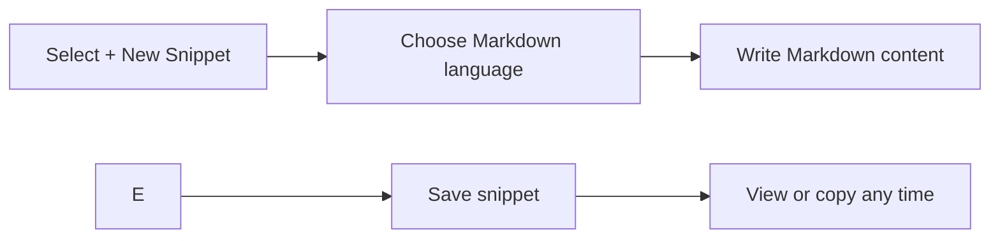

# MDX and markdown authoring

Markdown is one of the supported snippet types in CodeKnit. Authoring in Markdown is for anyone who wants to save, reuse, and organize formatted text, documentation excerpts, notes, README fragments, or writing templates. You write in plain text with Markdown formatting, and CodeKnit colors the syntax as you type so headings, links, bold text, and other formatting are easy to spot.

You store your Markdown content as reusable snippets, just like code snippets. You can title them, group them by category, add tags, mark them as favorites, and copy them whenever you need them.

## Who it's for

- Documentation writers and note-takers who want a fast way to save reusable Markdown blocks
- Developers who frequently write README excerpts, API documentation, or formatted messages
- Anyone who reuses formatted text and wants it one click away

## What you can do

When you create a Markdown snippet, you get the same snippet features as any other content type:

- Give the snippet a **title** and optional **description**
- Choose **Markdown** as the language
- Assign a **category** (for example, Documentation) or create a custom one
- Add **tags** for easy filtering later
- Mark it as a **favorite** for quick access
- Save it to your library, then **copy** it with one click

CodeKnit highlights Markdown-specific formatting as you write. Headings, bold text, links, and other Markdown elements appear in distinct colors so you can quickly scan your content while editing.

## About MDX

CodeKnit currently treats Markdown as a plain-text format with syntax highlighting. It does not render a live preview, and it does not process MDX-specific features such as embedding interactive components, validating front matter, or transforming images. You can store MDX-flavored text in a Markdown snippet, but the editor displays the raw text with basic Markdown highlighting rather than executing or rendering embedded components.

## Creating markdown content

The workflow for Markdown is the same as for any snippet:

1. Select **+ New Snippet**
2. Choose **Markdown** from the language list
3. Write or paste your Markdown content in the editor
4. Add a title, description, category, and tags
5. Save the snippet

While you type, the editor shows line numbers, supports Tab for indentation, and updates the syntax colors based on the Markdown language you selected.

Figure: Creating a Markdown snippet in CodeKnit

## Viewing and copying markdown

After you save a Markdown snippet, it appears in your library with a syntax-highlighted preview. You can open it to see the full content, copy it to your clipboard, edit it, or delete it. Markdown snippets behave the same as code snippets when it comes to organizing: they appear in search results, can be filtered by language, category, or tags, and can be starred as favorites.

## Limits and current boundaries

- **No live rendered preview**, the editor shows syntax-highlighted Markdown source, not a fully rendered page
- **No MDX component rendering**, interactive components embedded in MDX are not executed or displayed as interactive elements
- **No front matter validation**, front matter added to the top of Markdown content is kept as plain text, but CodeKnit does not validate or process it
- **No image optimization or transformation**, images referenced in Markdown are stored as plain-text links and are not processed

## Related

- [Code Editor](doc:a1109ff6-5fe7-437a-99ec-4d0b442bb0fd), learn about the editor features in detail
- [Syntax Highlighting](doc:0cc5fd84-0d94-4faf-ab51-00f580e726a4), how CodeKnit colors code and Markdown
- [Snippet Library](doc:9f431e10-b005-4cc0-80b1-0af4acdcb3d8), where your Markdown snippets are stored
- [Snippet Organization](doc:8367ddb8-1051-4848-a093-3b4352805aa4), how to categorize and tag snippets
- [Copy to Clipboard](doc:fe088c40-690b-45b1-ab17-d2fd7e259b72), copy your Markdown with one click
