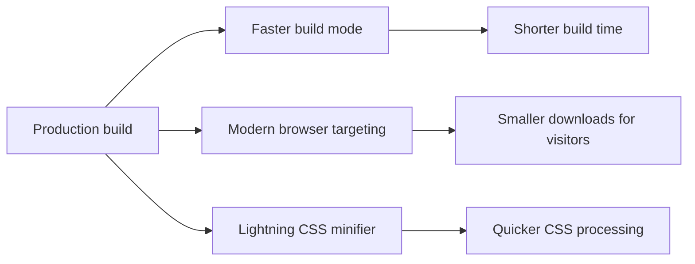

# Performance optimization

Performance Optimization brings together optional build‑time settings that make your production builds faster and produce smaller files for modern browsers. It's for developers and site administrators who publish the site and want to cut the time between making a change and seeing it live, without changing anything your visitors read.

## What it does

These optimizations focus on two goals:

- **Quicker builds** for the people publishing the site
- **Smaller downloads** for the people visiting the site

Each option is independent, so you can enable one, two, or all three depending on what matters most for your site.

## Who it's for

This feature is for developers and site administrators who run production builds, review build performance, or care about page-load speed. Content authors and readers don't need to change anything, the optimizations work at the build level, behind the scenes.

## Key options

### Faster build mode

Use this when production builds feel slow. Faster build mode swaps in a faster bundler for building the site, which shortens how long you wait each time you publish changes.

### Modern browser targeting

Use this to shrink the JavaScript and CSS your visitors download. The build serves code tailored to modern browsers and omits compatibility pieces meant for older ones. The main trade-off is that visitors on very old browsers may not see the site correctly.

### Lightning CSS minifier

Use this to shorten the time the build spends on CSS. Lightning CSS processes and minifies CSS quickly, which becomes especially valuable as your site's styling and stylesheets grow.

Figure: Optional build optimizations and their primary benefit

## How the options work together

You can combine these optimizations in any way that fits your site. Enabling modern browser targeting doesn't require faster build mode, and Lightning CSS works with or without the others. Together they can reduce both the time it takes to publish and the time it takes visitors to load the site.

## Limits and considerations

- **Modern browser targeting is a deliberate trade-off.** Smaller files come at the cost of support for older browsers.
- **Each optimization is opt-in.** If you must support legacy visitors, leave modern browser targeting off while still using faster build mode or Lightning CSS.
- **Lightning CSS affects CSS only.** JavaScript minification is handled separately.

> [!NOTE]
> These optimizations change how the site is compiled for visitors, not the content you author. Your pages, posts, and styling remain the same.

## Related

- [How to enable faster build mode](doc:c4b28fd3-840d-4199-8d25-b0db7d1b0e49)
- [How to target modern browsers for smaller bundles](doc:36850db2-85e1-488f-86f5-c1f20dedd653)
- [How to use Lightning CSS minifier for CSS](doc:2d0d054d-e3f5-4e92-9cf6-3df3438327a7)
- [CSS Optimization](doc:9c358234-bd9b-41b5-8c0e-dc1b8be5ce61)
- [Site Building & Bundling](doc:0fcd8337-ee59-484f-bda3-4db080caa340)
