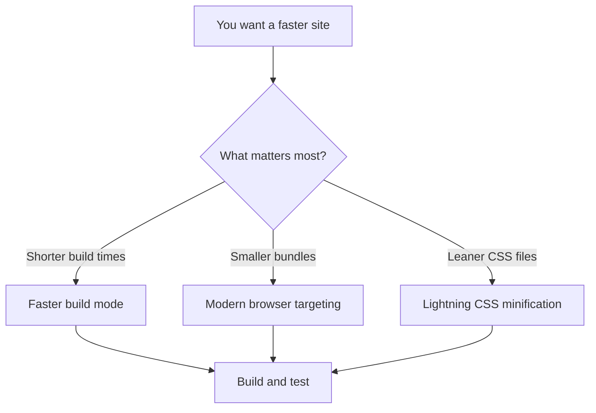
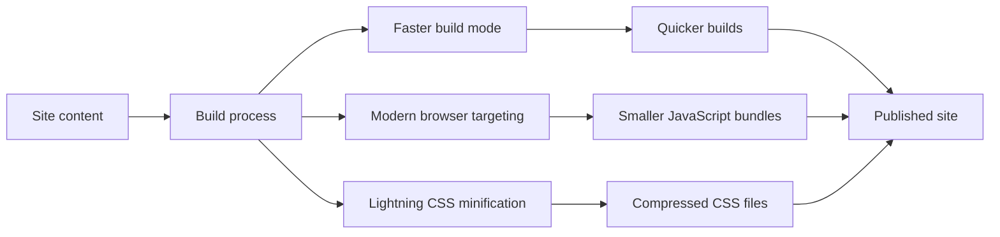
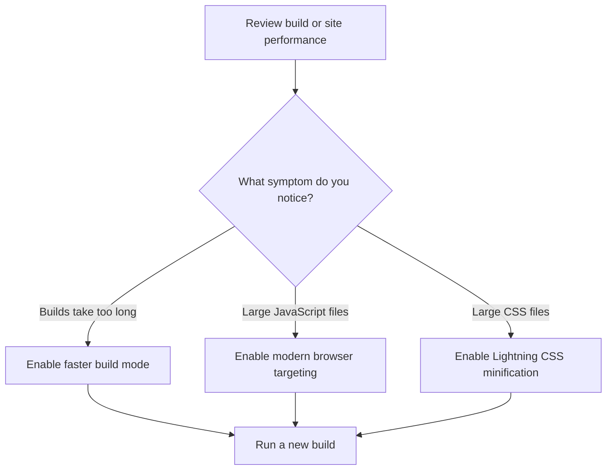

# Performance optimization

Performance Optimization gives you optional build settings that make your documentation site build faster and serve smaller, more efficient files to visitors. It's for developers and site administrators who want a quicker build experience and a faster website without changing content or design.

## What you can optimize

Performance Optimization covers three main capabilities.

- **Faster build mode** reduces the time it takes to produce a build, which helps when you build often during local development or when publishing repeated updates.
- **Modern browser targeting** reduces the size of JavaScript bundles by focusing on recent browser versions and dropping support for older ones.
- **Lightning CSS minification** compresses CSS files more efficiently, so visitors download less styling code.

You can enable these options independently. They affect build output only, not your content or theme.

Figure: Performance optimization options

## How the pieces fit together

When you enable an optimization, the build process applies it before generating the final files that visitors receive. Each option targets a different part of that process.

Figure: How build optimizations affect the final output

## Why use it

- Build faster when you iterate repeatedly, such as during a documentation refresh.
- Serve smaller files to visitors on modern browsers, which can improve page load times.
- Lower the amount of CSS sent to visitors.
- Keep your content and design unchanged while changing only build behavior.

## Before you enable an option

You need a working site that builds successfully and access to change your site's main configuration file. You should also have a current production build available so you can compare the result after enabling an optimization.

## Choosing an option

Use **faster build mode** when builds feel slow and you want a quicker feedback loop. Use **modern browser targeting** when you are confident your audience uses recent browsers and you want smaller bundles. Use **Lightning CSS minification** when you want to reduce CSS size without changing your styles.

These choices are not mutually exclusive, but you should build and review your site after enabling any of them.

Figure: Choosing an optimization by outcome

## Limitations and considerations

- **Modern browser targeting** drops support for older browsers. If some of your visitors use older browser versions, enabling this option may affect their experience.
- The exact behavior of each option can depend on your site's current configuration. Always test a production build after changing an optimization setting.
- These are optional build optimizations. Your site still builds and runs correctly if you leave them off.

> [!NOTE]
> Performance Optimization settings affect generated output, not your source content. You can turn them on or off without editing your pages.

## Related guides

- [Enable faster build mode](doc:c4b28fd3-840d-4199-8d25-b0db7d1b0e49)
- [Target modern browsers for smaller bundles](doc:36850db2-85e1-488f-86f5-c1f20dedd653)
- [Use Lightning CSS minifier for CSS](doc:2d0d054d-e3f5-4e92-9cf6-3df3438327a7)
- [How to build production site](doc:23e09652-4772-4f32-a5b7-0121a8bc4853)
- [How to measure build performance and memory usage](doc:2b46c98f-8208-4348-b81b-fbe839c07966)
- [How to minify CSS assets for production](doc:ecfad4a4-133c-46ec-ac33-4d5b0d637ab3)
