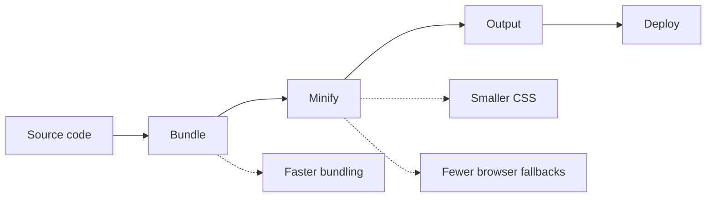

# Performance optimization

Optimize how CodeKnit builds and bundles your site, so production output is faster to generate, smaller to download, and quicker to load. These are optional build-time settings that reduce friction during development and improve what visitors receive in the browser.

## Who it is for

Performance Optimization is for developers who build, preview, and deploy the site. It is useful when you want:

- Shorter wait times between code changes and a finished build
- Smaller production bundles that load faster for visitors
- Control over which browsers your site commits to supporting

## Why it matters

Performance optimization applies at build time, not while browsing the site. The goal is to produce a lean production build and make producing that build as efficient as possible.

- **Faster builds** shorten the loop between making a change and seeing it ready to ship
- **Smaller bundles** mean less data for visitors to download, especially on slow connections
- **Modern browser targeting** removes compatibility code for older browsers, reducing bundle size
- **Efficient minification** shrinks CSS and other assets without changing what they do visually

## How the optimization pipeline works

Performance optimization operates in stages: the project source is bundled, then minified, and finally emitted as output for deployment. Each stage has a faster or smaller option available.

Figure: Build optimization pipeline

## Key options

### Enable faster build mode

Choose this option when build speed matters more than performing a full type-check during every build. Faster build mode speeds up transpilation and skips optional type-checking work, leaving comprehensive checks to be run separately.

For step-by-step instructions, see [How to enable faster build mode](doc:c4b28fd3-840d-4199-8d25-b0db7d1b0e49).

### Target modern browsers for smaller bundles

When you target only modern browsers, the build drops compatibility layers that older browsers require. This produces smaller, faster bundles at the cost of leaving very old browsers unsupported.

For step-by-step instructions, see [How to target modern browsers for smaller bundles](doc:36850db2-85e1-488f-86f5-c1f20dedd653).

### Use lightning CSS minifier for CSS

Switch from the default CSS minifier to Lightning CSS for faster CSS builds and a smaller final CSS file. Lightning CSS can also remove unused custom properties.

For step-by-step instructions, see [How to use Lightning CSS minifier for CSS](doc:2d0d054d-e3f5-4e92-9cf6-3df3438327a7).

The CSS minifier is one part of the larger CSS pipeline. See [CSS Optimization](doc:9c358234-bd9b-41b5-8c0e-dc1b8be5ce61) for more context.

## Limits to understand

- **Modern browser targeting** means the site is not intended to support older browsers
- **Faster build mode** trades full type-checking for speed, so separate validation is still important
- **Lightning CSS** is not enabled by default; you must opt in
- **Rolldown** is fixed at a specific version in the project configuration

## Get the most from optimizations

For the fast-paced, low-friction build workflows:

- Turn on **faster build mode** for daily iteration
- Switch CSS minification to **Lightning CSS** to speed up CSS output and reduce size
- Use **modern browser targeting** when your visitors use current browsers

For broader context on how the site is assembled, see [Site Building & Bundling](doc:0fcd8337-ee59-484f-bda3-4db080caa340). For the production build workflow specifically, see [How to build production site](doc:23e09652-4772-4f32-a5b7-0121a8bc4853).
