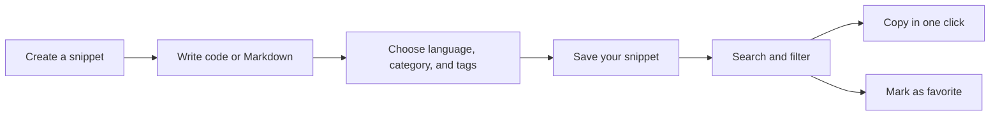

# CodeKnit product overview

CodeKnit is a lightweight code and Markdown snippet manager that helps you store, organize, and quickly reuse the text you use most. Instead of hunting through old projects or chat threads, you keep your reusable code blocks, queries, and text templates in one searchable place.

## What you can do with CodeKnit

CodeKnit focuses on a simple, fast workflow: save a snippet once, then find and copy it whenever you need it.

Figure: The core CodeKnit workflow

1. Create a snippet with a title, and add code or Markdown text.
2. Assign a language, category, and tags so it's easy to find later.
3. Search across your library by keyword, language, category, or favorites.
4. Copy any snippet to your clipboard with one click.

## Who CodeKnit is for

CodeKnit is for developers and anyone who regularly reuses small pieces of text. It's especially useful when you:

- Write the same SQL queries, JavaScript functions, or Python snippets repeatedly.
- Keep reusable Markdown templates for documentation, pull requests, or notes.
- Want a personal library that doesn't depend on a specific editor or project.

## Main benefits

- **Fast, local-first storage**, your snippets stay close at hand, without complex setup.
- **Syntax-aware editing**, the editor understands the language you're working in.
- **Search across languages**, find snippets in JavaScript, Python, SQL, Markdown, and other formats.
- **Organize by category**, group related snippets so your library stays manageable.
- **Favorites for quick access**, star the snippets you use most and filter to them instantly.
- **Full import and export**, back up your library or move it between devices as a portable file.

> [!NOTE]
> CodeKnit keeps your workflow lightweight. You don't need to maintain a database or configure a server to start saving snippets.

## What this documentation teaches

This guide walks you through the entire CodeKnit experience, from first launch to everyday use:

- **Getting started**, set up CodeKnit and create your first snippet.
- **Managing snippets**, edit, organize, and mark snippets as favorites.
- **Finding snippets**, use search, language filters, categories, tags, and favorites.
- **Importing and exporting**, back up and restore your snippet library.
- **Customizing your setup**, adjust settings to match the way you work.

If you're ready to begin, start with [your first snippet](doc:72dab710-31b9-4980-becf-be9fbd6d4d94) or review the [system requirements and installation](doc:1016cd5f-d53c-46d7-a74a-15b623ef5387) steps.

To understand how snippets are organized, see [snippet organization](doc:8367ddb8-1051-4848-a093-3b4352805aa4) and [how snippets and filters work together](doc:5aa23d07-2c0d-44f6-8a85-df82ca070b77). For a deeper look at the main feature area, read about the [snippet library](doc:9f431e10-b005-4cc0-80b1-0af4acdcb3d8).
