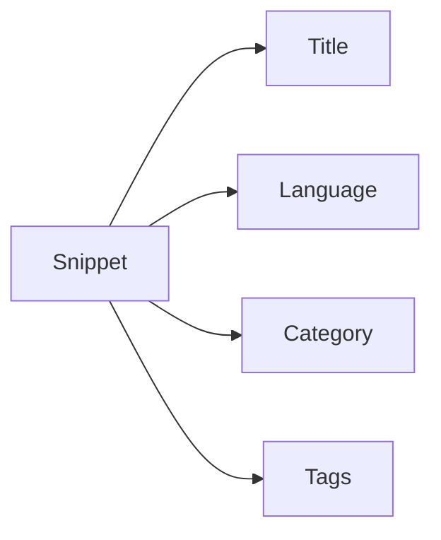
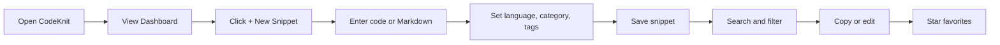

# CodeKnit product overview

Save, find, and reuse your code and Markdown snippets in one place. CodeKnit is a lightweight snippet manager built for fast, local-first work. It helps you stop hunting through old files or browser tabs every time you need a piece of code or text.

## Who CodeKnit is for

CodeKnit is for anyone who repeatedly uses the same code or text. That includes:

- Developers who reuse functions, queries, configuration examples, and templates
- Data analysts and engineers who keep SQL queries, scripts, and command snippets
- Technical writers and content authors who reuse Markdown blocks and documentation text
- Students and learners who want a personal reference library for examples and notes

## What you can do with CodeKnit

CodeKnit turns scattered snippets into an organized, searchable library.

- Create new snippets with a title, language, category, and tags
- Search across all snippets by text, language, category, or favorites
- Copy a snippet to your clipboard with one click
- Mark important snippets as favorites
- Edit or update snippets as your needs change
- Back up your library or restore it by importing and exporting snippet data

Supported snippet languages include JavaScript, Python, SQL, and Markdown.

## A library that stays organized

Every snippet is organized by a few simple labels. The diagram below shows how one snippet relates to the labels you can use to find it later.

Figure: How CodeKnit organizes a snippet

A snippet contains the actual code or Markdown text you want to save. Its title helps you recognize it at a glance. Its language helps CodeKnit highlight and categorize it. Categories group related snippets, and tags add extra keywords for flexible filtering. For example, you could save a Python function with the category`API helpers` and tags like`auth` and`requests`.

## Your typical workflow

Your path through CodeKnit usually follows the same short loop: open the **Dashboard**, create or find a snippet, and reuse it.

Figure: Typical CodeKnit workflow

When you start, the **Dashboard** gives you an at-a-glance summary of your library. From there, you can create a new snippet or search for an existing one. Once you find the right snippet, you can copy it, edit it, or mark it as a favorite for quicker access later.

## What this documentation covers

The documentation teaches you how to set up CodeKnit, create and manage snippets, and find them again quickly.

- To set up CodeKnit, see [System Requirements and Installation](doc:1016cd5f-d53c-46d7-a74a-15b623ef5387)
- To create your first saved snippet, follow [Your First Snippet – Quick Start](doc:72dab710-31b9-4980-becf-be9fbd6d4d94)
- To understand how the library works, see [Snippet Library](doc:9f431e10-b005-4cc0-80b1-0af4acdcb3d8)
- To organize snippets with categories and tags, see [Snippet Organization](doc:8367ddb8-1051-4848-a093-3b4352805aa4)
- To find snippets by text, language, category, or favorites, see [Search and Filter](doc:3704cb56-cf68-421d-9db0-d3816a8af756)

Start by installing CodeKnit and creating your first snippet. If you already have a library, use the import option to bring your existing snippets into CodeKnit.
