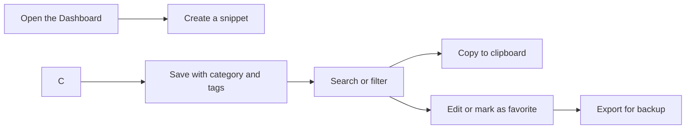

# CodeKnit: Overview

CodeKnit is a small, fast home for the code snippets and text templates you reuse every day. Instead of digging through old files or rewriting the same function from memory, you save it once in CodeKnit and bring it back with a quick search or a single click.

## What you can do with CodeKnit

- **Store** code in many languages and Markdown text in one place.
- **Organize** snippets by category and tags so related items stay together.
- **Find** anything quickly with search, language filters, category filters, and favorites.
- **Copy** any snippet to your clipboard instantly when you need it.
- **Back up and restore** your whole library with import and export.

## Who CodeKnit is for

CodeKnit is for anyone who works with reusable text. Developers use it to keep JavaScript functions, Python scripts, and SQL queries within reach. Writers and content creators use it for Markdown templates and repeated blocks of text. If you find yourself copying the same text or code more than once, CodeKnit can help.

## Why use CodeKnit

- **Fast, local-first storage**, your snippets live on your own device, so they're always ready without waiting for a remote server.
- **Syntax-aware editing**, the editor understands the language of each snippet and helps you write clearly with highlighting and structure.
- **Easy organization**, categories, tags, and favorites let you arrange snippets your way.
- **Full import and export**, move your library between devices or share it as a single file.

## How CodeKnit fits together

Here's the typical flow from starting point to a finished snippet you can reuse.

Figure: Typical snippet workflow

That diagram shows the path most people follow. You don't need every step, it's fine to create a snippet and copy it right away, or to export a library you've been building for months.

## What this documentation teaches

This collection of guides walks you through everything from first launch to daily use:

- **Getting started**, install CodeKnit and create your first snippet. See [System Requirements and Installation](doc:1016cd5f-d53c-46d7-a74a-15b623ef5387) and [Your First Snippet – Quick Start](doc:72dab710-31b9-4980-becf-be9fbd6d4d94).
- **Managing snippets**, organize with categories and tags, mark favorites, and understand the library. See [Snippet Organization](doc:8367ddb8-1051-4848-a093-3b4352805aa4).
- **Finding snippets**, use search and filters to locate exactly what you need. See [Search and Filter](doc:3704cb56-cf68-421d-9db0-d3816a8af756).
- **Backing up and sharing**, export and import your library. See [Import and Export](doc:f1b42dc6-1597-47d7-b921-658815f5af20).

If you're ready to begin, start with setting up and creating your first snippet.

- [System Requirements and Installation](doc:1016cd5f-d53c-46d7-a74a-15b623ef5387)
- [Your First Snippet – Quick Start](doc:72dab710-31b9-4980-becf-be9fbd6d4d94)
- [Snippet Library](doc:9f431e10-b005-4cc0-80b1-0af4acdcb3d8)
