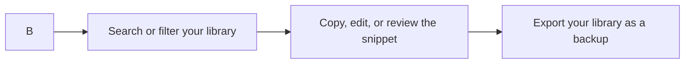

# CodeKnit product overview

CodeKnit is a lightweight snippet manager for saving, organizing, and reusing code and Markdown text. Instead of digging through old files or retyping the same block of code, you keep your most-used snippets in one place and find them in seconds.

## What you can do

- Save code and Markdown snippets with a title, language, category, and tags.
- [Find snippets](doc:3704cb56-cf68-421d-9db0-d3816a8af756) by searching across JavaScript, Python, SQL, Markdown, and other languages.
- [Organize snippets by category](doc:8367ddb8-1051-4848-a093-3b4352805aa4) and [mark favorites](doc:b66c5560-9b68-42eb-922d-a8aecab0dfcb) for quick access.
- [Copy any snippet](doc:fe088c40-690b-45b1-ab17-d2fd7e259b72) to your clipboard with one click.
- [Edit snippets](doc:a1109ff6-5fe7-437a-99ec-4d0b442bb0fd) in a readable, syntax-aware editor.
- [Export your entire library](doc:f1b42dc6-1597-47d7-b921-658815f5af20) to a single file for backup or sharing, and import it again when needed.

## Who CodeKnit is for

CodeKnit is for anyone who works with reusable text, but it's especially useful for developers. If you regularly reuse SQL queries, JavaScript functions, Python scripts, or Markdown templates, CodeKnit keeps them organized and within reach.

## How CodeKnit fits together

The main workflow is simple: create a snippet, organize it, find it later, and use it. The sidebar filters your library by language, category, and favorites, while the search box finds any snippet by its title or contents.

Figure: CodeKnit main workflow

## Key benefits

**Fast, local-first storage.** Your snippets are stored on your own device and are ready instantly, with no waiting on a remote service.

**Syntax-aware editing.** Write and edit snippets with highlighting that makes code and Markdown easier to read at a glance.

**Organized your way.** Use categories for broad grouping and tags for flexible labeling, then star the snippets you use most as favorites.

**Search across everything.** Find snippets by title, text, language, or tag, whether it's a SQL query or a Markdown template.

**A portable library.** Export your entire snippet library to one file for backup or sharing, and restore it whenever you need.

## What this documentation covers

1. Install CodeKnit and get it running on your computer.
2. Create and save your first snippet.
3. Organize snippets with categories, tags, and favorites.
4. Find snippets with search and filters.
5. Edit and copy snippets.
6. Back up and restore your library with import and export.

## Next steps

- [System Requirements and Installation](doc:1016cd5f-d53c-46d7-a74a-15b623ef5387)
- [Your First Snippet – Quick Start](doc:72dab710-31b9-4980-becf-be9fbd6d4d94)
- [Concepts and Terminology](doc:08c7b9ec-c366-4fc5-b62c-01999c0ae167)
