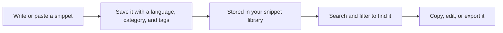

# CodeKnit at a glance

CodeKnit is a lightweight home for the code and text you reuse every day. Instead of hunting through old projects or scattered notes, you save each reusable snippet once with a title, language, and category. When you need it again, you search, click, and copy.

## Who CodeKnit is for

CodeKnit is for anyone who works with text they'd rather not retype. Developers can keep JavaScript, Python, or SQL snippets close at hand. Writers and note-takers can store Markdown templates and messages they use often. No database setup is required, your library lives on your device and stays under your control.

## Why you'll like it

- **One searchable library**, every snippet is indexed by language, category, and tags, so you can find things even when you remember only a word or two.
- **Copy in one click**, grab a snippet and paste it wherever you're working.
- **Stay organized**, group related snippets into categories and tag them so your library stays tidy.
- **Mark favorites**, star the snippets you reach for most and filter down to them instantly.
- **Take your library with you**, export everything to a single file and import it on another device.

## How the pieces fit together

Here's how a snippet typically moves through CodeKnit:

Figure: How a snippet moves through CodeKnit

## What you can do

- **Snippet Library**, store and retrieve all your code and text from one place
- **Code Editor**, write and edit snippets in a syntax-aware editor
- **Syntax Highlighting**, see code and Markdown colorized as you type
- **Search and Filter**, find snippets by keyword, language, category, or favorites
- **Favorites**, star snippets for quick access
- **Snippet Organization**, group snippets with categories and tags
- **Copy to Clipboard**, copy snippet content in a single click
- **Import and Export**, back up, share, and restore your library

## What this documentation teaches

Start with [System Requirements and Installation](doc:1016cd5f-d53c-46d7-a74a-15b623ef5387) to get CodeKnit running. Then create your first snippet with the [Quick Start guide](doc:72dab710-31b9-4980-becf-be9fbd6d4d94). If you'd like to understand how CodeKnit organizes things before diving in, read [How Snippets and Filters Work Together](doc:5aa23d07-2c0d-44f6-8a85-df82ca070b77).

## Next steps

- Learn the core ideas in [Concepts and Terminology](doc:08c7b9ec-c366-4fc5-b62c-01999c0ae167)
- Explore the [Snippet Library](doc:9f431e10-b005-4cc0-80b1-0af4acdcb3d8) in detail
- See how fast retrieval works in [Search and Filter](doc:3704cb56-cf68-421d-9db0-d3816a8af756)
