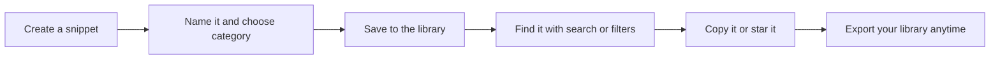
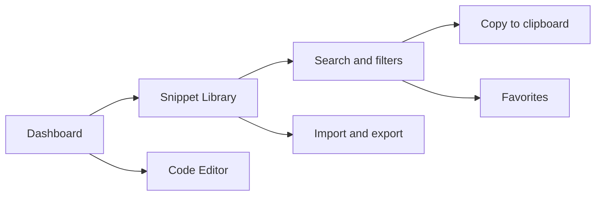

# CodeKnit product overview

CodeKnit is a simple, fast home for your reusable code snippets and text templates. Save a piece of code or a block of text once, keep it organized, and copy it the moment you need it again, no more digging through old projects or half-remembered files.

## What CodeKnit is

Think of CodeKnit as a personal library for the small pieces of text you write over and over. You can store short code blocks in many languages, Markdown notes, message templates, and boilerplate text in one searchable collection. Each snippet has a title, a language, a category, and tags so you can find it quickly later.

CodeKnit runs in your browser and keeps your snippets close at hand. You don't need to set up a separate server or a database to start saving snippets.

## Who CodeKnit is for

CodeKnit is for developers and anyone who works with reusable text on a regular basis. It's especially helpful if you:

- Write code in several languages and want one place for the pieces you reuse
- Keep standard blocks of text, such as replies, comments, or code scaffolding, and want to access them instantly
- Prefer to find a snippet by name, language, category, tag, or favorite status instead of skimming through files

## Why use CodeKnit

The core value is simple: spend less time retyping and more time using what you already wrote.

- **One searchable library.** Keep snippets across JavaScript, Python, SQL, Markdown, and other formats in a single place.
- **Organize your way.** Group snippets by category and tag them so related items appear together.
- **Find anything fast.** Search by text, filter by language or category, and star the snippets you use most.
- **Copy instantly.** Move a snippet to your clipboard with one click.
- **Take your library with you.** Export your snippets to a single file for backup or sharing, and import them when you need to restore them.

Figure: What you can do with a snippet in CodeKnit

## A tour of the main workspaces

When you open CodeKnit, the **Dashboard** gives you an at-a-glance summary of your snippet library. From there, the sidebar takes you to the areas where you do your day-to-day work.

The **Snippet Library** is where your saved snippets live. The **Code Editor** is where you write or edit the text of a snippet, with helpful color highlighting for code and Markdown. **Search and Filter** lets you narrow the list by typing a search term and choosing a language, category, or favorites view.

Figure: The main areas of CodeKnit

## What you'll learn in this documentation

This documentation guides you through the full snippet workflow:

- Getting CodeKnit running on your machine
- Creating and saving your first snippet
- Organizing snippets with categories and tags
- Searching, filtering, and marking favorites
- Editing and copying snippets
- Backing up and restoring your library with import and export

> [!TIP]
> Export your snippet library regularly so you always have a safe backup.

Start with the [Quick Start](doc:72dab710-31b9-4980-becf-be9fbd6d4d94) to create your first snippet, or read the [Key Concepts and Terminology](doc:08c7b9ec-c366-4fc5-b62c-01999c0ae167) page to get familiar with the words used throughout CodeKnit. To explore a specific area, see the [Dashboard](doc:0cccb845-62f3-4e2b-b0ca-c7d768eaf700), [Snippet Library](doc:9f431e10-b005-4cc0-80b1-0af4acdcb3d8), [Search and Filter](doc:3704cb56-cf68-421d-9db0-d3816a8af756), or [Import and Export](doc:f1b42dc6-1597-47d7-b921-658815f5af20) pages.
